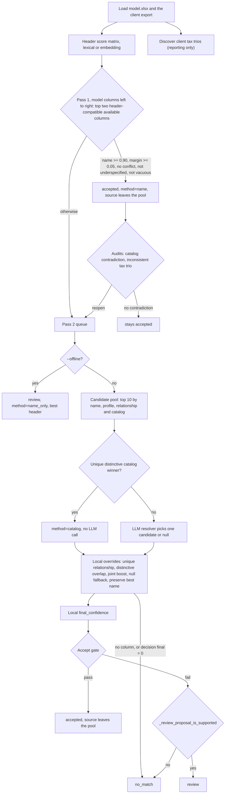

# Architecture

How the column mapper decides, written for someone who will change it. It follows one client export from loading to the delivered workbook, states every rule and threshold, and ends with where to make common changes.

Related documents: setup and commands in the [README](../README.md), the workbooks under `data/` in [DATA.md](DATA.md), scoring a change in [EVALUATION.md](EVALUATION.md), and behavior that is wrong or surprising in [KNOWN_ISSUES.md](KNOWN_ISSUES.md). This document describes what the code does today; where that is surprising it links to KNOWN_ISSUES.md rather than repeating the analysis.

## Contents

- [Rules every change must respect](#rules-every-change-must-respect)
- [Vocabulary](#vocabulary)
- [Pipeline at a glance](#pipeline-at-a-glance)
- [Loading workbooks](#loading-workbooks)
- [Reading headers](#reading-headers)
- [Pass 1: name-only accepts](#pass-1-name-only-accepts)
- [Pass 2: evidence and adjudication](#pass-2-evidence-and-adjudication)
- [Offline mode](#offline-mode)
- [The mapping report](#the-mapping-report)
- [Step attribution](#step-attribution)
- [Reference catalogs](#reference-catalogs)
- [Applying a report](#applying-a-report)
- [Constants](#constants)
- [Where to make common changes](#where-to-make-common-changes)

## Rules every change must respect

- **Scope is the matching algorithm**: reading headers, combining evidence, assigning columns. A UI, reusing a client's earlier mapping, and scalability or cost are deliberately out of scope for now.
- **The four sample clients are reference examples, not the product.** datasul, oracle, sap_procosa and sap_terumo exist to learn strategies that transfer; production will see many ERPs and layouts nobody has seen. Never tune a rule to one of them and never branch on a client name. Validate a change leave-one-client-out: work it out on three clients and check it on the fourth. The answer keys are a regression test, never a training set.
- **Prefer evidence that transfers** to an unseen ERP (tax arithmetic, official code tables, CPF/CNPJ/NF-e check digits) over more header vocabulary. The share of accepts that rest on such evidence is the generalization metric to drive up (see [Step attribution](#step-attribution)).
- **Fabrication is the failure that matters.** Filling a model column from data the client does not have is far worse than leaving it empty, so accept precision outranks recall.
- **`data/model.xlsx` is a deliberately oversized superset, and it is immutable for now.** Any one client carries only part of it, so most model columns stay empty for a given client and `no_match` is often the correct answer.
- **The 0.90 accept gate stays.** Correct picks that land below it reach the client through reviewer adjudication, not a lower constant (see [The accept gate](#the-accept-gate)).

## Vocabulary

Brazilian tax terms the code and this document use:

| Term | Meaning |
|---|---|
| NF-e | Nota Fiscal eletrônica, the electronic invoice. Each one has a 44-digit access key (*chave de acesso*) that ends in a mod-11 check digit. |
| CNPJ, CPF | Taxpayer IDs for companies (14 digits) and individuals (11 digits). Both end in two check digits. |
| CFOP | 4-digit fiscal operation code on each invoice line, e.g. 5102 for an in-state sale of goods bought for resale. |
| NCM | 8-digit Mercosur product classification code. |
| CST, CSOSN | Tax situation code: a 2- or 3-digit code per tax saying how a line is taxed (taxed, exempt, suspended, ...). CSOSN is the variant used by companies in the Simples Nacional regime. |
| ICMS, IPI, PIS, COFINS, ISS | Today's consumption taxes: state VAT, federal excise on manufactured goods, two federal contributions on revenue, and the municipal service tax. |
| CBS, IBS, IS | The taxes created by the consumption-tax reform, phasing in from 2026: the federal CBS, the state and municipal IBS, and the selective excise IS. Model columns 1-28 hold one 7-column block each for CBS, IBSM, IBS and IS. |
| cClassTrib | 6-digit IBS/CBS tax classification code. |
| ST | *Substituição tributária*: tax collected upstream on behalf of the rest of the chain. Headers mark it with "ST". |
| base, alíquota, valor | Tax base, tax rate and tax amount. For one tax on one line, valor = base × alíquota. |
| Isentas, Outras, Base Reduzida | Exempt amount, other (non-taxed) amount, reduced base. |
| de-para | "From-to": a column mapping table. The clients wrote three `de_para_*.xlsx` files in `data/keys/`; the datasul and oracle ones are the answer keys, the procosa one is not (see [DATA.md](DATA.md#de_para_procosaxlsx-is-not-a-key)). |

## Pipeline at a glance

```text
data/clients/<export>.xlsx ─┐
data/model.xlsx ────────────┼─> invoice_mapper.py ─> mapping report ─> reviewer verdicts ─> apply_invoice_mapping.py ─> <client>_mapped.xlsx
reference_data/ ────────────┘     (two passes)       (4 sheets)        (in the report)       (copies values verbatim)
                                                          │
                                                          └─> python -m mapeval  (scores reports against data/keys/)
```

| File | Role | Main symbols |
|---|---|---|
| [`invoice_mapper.py`](../invoice_mapper.py) | CLI and the whole algorithm: header scoring, evidence, both passes, the report | `map_columns`, `main`, `write_results` |
| [`reference_catalog.py`](../reference_catalog.py) | Loads the checksummed official code tables and scores a column against one | `ReferenceCatalogs`, `expected_catalogs`, `best_catalog_evidence` |
| [`mapping_steps.py`](../mapping_steps.py) | Names the evidence steps and guards that the report cites | `EVIDENCE_STEPS`, `GUARDS`, `deciding_step`, `format_steps` |
| [`apply_invoice_mapping.py`](../apply_invoice_mapping.py) | Builds the model-shaped workbook from an export, a report and its reviewer verdicts | `build_mapped_workbook`, `_effective_columns` |
| [`backfill_mapping_steps.py`](../backfill_mapping_steps.py) | One-off tool that added the step columns to reports written before `mapping_steps.py`, in place | `backfill` |
| [`update_reference_data.py`](../update_reference_data.py) | Rebuilds `reference_data/`; downloads from government sites | `official_frames`, `static_frames`, `write_snapshot` |
| [`mapeval/`](../mapeval) | Scores the archived reports against the answer keys | see [EVALUATION.md](EVALUATION.md) |

## Loading workbooks

`SheetTable.from_excel` reads one sheet with `header=None, dtype=object`, so each cell keeps the value the Excel reader produced, with no column-wide type coercion. Code that needs a number parses it on the fly (`_numeric_value` handles `1.234,56`, a trailing minus and parenthesised negatives); nothing rewrites the data.

- The header row comes from `--model-header-row` / `--client-header-row` (1-based, default 1). Every row below it is data.
- A blank header becomes `Unnamed column N`.
- Headers that are equal after `normalize_header` get an occurrence counter: the second `Descrição` displays as `Descrição (occurrence 2)` (`ColumnRef.display_name`). The report identifies a client column by its 1-based number plus this display name.
- `data/model.xlsx` has 209 sample rows under its header. They matter: pass 2 profiles each model column from them.

## Reading headers

### Normalization and the semantic signature

`normalize_header` strips the text, folds it to ASCII (NFKD, accents dropped), lowercases it and turns every run of non-alphanumerics into one space.

`semantic_header_signature` turns that into a set of tokens:

1. Phrase rewrites. `tax situation` and `situacao tributaria` become `cst`. `(valor|vlr|val|vl) contab…` becomes `valor total nf`: in the Brazilian fiscal books "valor contábil" is the document total, and requiring the value word keeps `Conta Contábil` and `Data Contábil` out.
2. Stopwords in `_HEADER_STOPWORDS` are dropped (Portuguese and English articles and prepositions, plus `44` and `digit`).
3. Tokens are mapped through `_HEADER_TOKEN_ALIASES` (52 entries) to one Portuguese form: `vlr`/`val`/`value` → `valor`, `aliq`/`alq`/`rate`/`taxa` → `aliquota`, `nr`/`num`/`no`/`number` → `numero`, `invoice` → `nota`, and so on.
4. Only when `cst` is present, `pi` becomes `pis`.

Two headers with equal, non-empty signatures are semantically equivalent (`semantically_equivalent_headers`). Word order is irrelevant because the signature is a set: `Vlr Contabil` and `Valor Total NF` both give `{nf, total, valor}`.

### The name score

Both scorers return a model × client matrix in [0, 1]. `map_columns` computes it once per run.

| | `LexicalHeaderScorer` (offline) | `OpenAIEmbeddingHeaderScorer` (online) |
|---|---|---|
| Base score | 0.7 × `SequenceMatcher` ratio of the normalized strings + 0.3 × Jaccard of the signatures | Cosine similarity of `text-embedding-3-large` vectors for `"Brazilian invoice spreadsheet column: {header}"`, clipped to [0, 1]. Model and client headers are embedded in separate calls, deduplicated, 512 per request. |
| Identical normalized text | 1.0 | 1.0 |
| Equal signatures | at least `SEMANTIC_EQUIVALENCE_SCORE` = 0.98 | at least 0.98 |
| Step id in the report | `lexical` | `semantic` |

Equal signatures therefore clear the 0.90 name threshold, while 1.0 stays reserved for identical text. Measured with the lexical scorer: `Valor Total NF` against `Vlr Contabil` scores 0.98, against `Conta Contabil` 0.20. `map_columns` reports the header step as `lexical` when the scorer is a `LexicalHeaderScorer` and `semantic` for any other scorer, including the test doubles.

### Tax families, roles and truncated role words

The guards and the arithmetic need to know which tax a header is about and which slot it names.

- **Family.** `header_tax_families` intersects the signature, after `_TAX_FAMILY_ALIASES` (`cof`/`cofi` → `cofins`, `fcp` → `fecp`, `ibss` → `ibs`), with the 16 names in `_TAX_FAMILIES`: cbs, cofins, csll, fecp, icap, icep, icms, icsp, ibs, ibsm, inss, ipi, irpj, iss, iva, pis. A tax that is not on the list has no family. The model's IS and DIF_ALIQ blocks and a truncated `ICM` carry none, so neither the family guard nor the arithmetic scope applies to them (see [KNOWN_ISSUES.md](KNOWN_ISSUES.md)).
- **Role.** `header_semantic_role` returns the first role that matches, in this order: `tax_classification`, `tax_status`, `rate`, `other`, `exempt`, `reduced_base`, `base`, `value`, `tax_group`, `product_group`, `tax_rule`, `text`, `unit_of_measure`, `unit_price`, `nfe_key`, `party_tax_id`, `regional_tax_id`, `item_id`, `document_id`, else `None`. Two refinements: a rate reading that rests only on an abbreviation such as `aliq` yields to an explicit slot word (`DIF_ALIQ Base` is a base, while `Tax rate (Tax/Base)` stays a rate), and `Mont.`/`Montante` means base inside a tax-family header and value elsewhere.
- **Truncated role words.** ERPs cut headers short, so the role word often arrives as `Isen`, `Outr` or `Red`. `expand_truncated_role_words` adds the full word for a token that is a prefix, at least `_MIN_ROLE_PREFIX` = 3 characters long, of exactly one concept in `_ROLE_CONCEPT_WORDS` (other, exempt, reduced). The resulting index `_ROLE_PREFIXES` holds 21 prefixes. Expansion only adds tokens, never replaces them. `test_the_role_vocabulary_is_prefix_unambiguous` fails if a new word makes any prefix reach two concepts.
- **Scope.** `tax_calculation_scope` returns `(family, qualifiers)` for the arithmetic: exactly one family, plus any of `st`, `icop`, `dif`, `diferencial`. A header naming two families (`Base ICMS_FECP`) has no scope. The model has 14 scopes with a base, a rate and a value column each.

### Guards

A guard is a reason to refuse an accept. Pass 1 refuses on any of them; pass 2 treats them slightly differently (see [The accept gate](#the-accept-gate)).

| Guard | Function | Fires when |
|---|---|---|
| `family_conflict` | `semantic_header_conflict` | Both headers name tax families and they are disjoint (ICMS vs ICSP); or they share a family but only one says `ST`; or both have a role and the roles differ (base vs value). A header with no family or role never conflicts. |
| `underspecified` | `underspecified_header_match` | The client signature is a single token and a strict subset of a multi-token model signature (`Centro` for `Centro custo`). |
| `vacuity` | `client_column_is_vacuous` | The client column has no non-blank cell. A column of zeros is not vacuous: zero is ordinary fiscal data. |
| `exclusivity` | the `available` set in `map_columns` | The client column is already consumed by an accept. |

## Pass 1: name-only accepts

`map_columns` walks the model columns left to right. For each one, `_rank_header_compatible` ranks the client columns still in `available` by name score, drops those with a header conflict (unless every one conflicts) and keeps the top two. The pair is **accepted** when all of these hold:

- name score ≥ `name_threshold` (0.90);
- lead over the second compatible column ≥ `name_margin_threshold` (0.05);
- no `semantic_header_conflict`;
- not `underspecified_header_match`;
- the client column is not vacuous.

An accept gets `method=name` and `final_confidence` = the name score. If a discovered tax trio places this client column in this slot it also gets an `arithmetic_proof` (see [Tax-trio discovery](#evidence)). The client column leaves `available`. Every other model column is queued for pass 2. If no client column is left at all, the row is `no_match` at once.

Order matters. An accepted source leaves the pool, so an earlier model column has first claim on a header, and a later column's margin is measured only against what is left. A conflicting runner-up does not block an accept, because conflicting columns are dropped from the ranking first.

### Audits that reopen pass-1 accepts

Two checks run between the passes. Each can delete an accept, put its client column back in `available` and queue the model column for pass 2.

1. **`_audit_accepted_catalog_matches`.** For each accept whose model header routes to a catalog (see [Reference catalogs](#reference-catalogs)) it scores the client column and writes `catalog_name`, `catalog_coverage`, `catalog_distinct_coverage` and `catalog_confidence` onto the row. It reopens the accept on a clear contradiction: the catalog has specificity ≥ 0.90 (CFOP, NCM, IBGE), the column has at least 5 values, at least 90% of them are well-formed codes, yet fewer than 10% of rows hold a valid code, and the valid codes are not all zeros.
2. **`_demote_inconsistent_tax_header_matches`.** For each tax scope whose base, rate and value are all accepted, it tests valor = base × alíquota on those columns. If that does not score at least 0.90, it tries, slot by slot, every informative available column that would score at least 0.90 in that slot. If such columns exist and the best swap improves that slot's score by at least 0.50, the slot is reopened; if they exist but none improves it that much, nothing is reopened. If no such column exists and the current trio is a strong contradiction (at least 20 rows tested, coverage at least 0.80, fit at most 0.20), the slot with the weakest name score is reopened. At most one slot per scope is reopened.

## Pass 2: evidence and adjudication

Pass 2 visits the queued model columns in ascending column order. A pass-2 accept also consumes its source, and also becomes an anchor for the arithmetic of later targets.

### Profiles and the candidate pool

`summarize_values` profiles a column: counts, inferred type, numeric, digit and alpha fractions, length and digit-count statistics, numeric quantiles, the fraction of values with valid CPF, CNPJ and NF-e check digits, an `evidence_quality` of `empty`, `all_zero` or `informative`, and up to `sample_size` (8) sample values. `sample_values` picks the two most frequent values and then values spread evenly over the sorted distinct values, each cut to 100 characters, so the choice does not depend on row order.

The **target profile is built from the model column's own sample rows in `data/model.xlsx`**, not from any client. In the current model, 93 columns have informative samples, 87 hold only zeros and 47 are empty. For the last two groups the profile, overlap and identifier evidence below cannot fire; catalog and arithmetic evidence read only client data and still can.

The candidate pool for a target:

- **Online** (`_rank_name_and_profile_candidates`): the union of the top `candidate_count` (10) available columns by name score, by `profile_similarity` (only scores > 0), by relationship score (> 0) and by catalog score (> 0). At most 40 columns, sorted by name score.
- **Offline** (`_rank_available`): the top 10 by name score.

### Evidence

**Relationship arithmetic** (online only). `_candidate_relationship_evidence` applies when the target is a base, rate or value column with a tax scope and the other two slots of that scope are already *accepted*. Each candidate is tried in the open slot and scored by `tax_calculation_evidence`. The same is done for quantity × unit price = line value (`line_calculation_evidence`; the model's `Quantidade`, `Preço líq.` and `Valor Total do Item`).

`tax_calculation_evidence` uses the rows where base ≠ 0 and either rate ≠ 0 or |value| > 0.02, and needs at least 5 such rows with all three numbers. It tries the rate both as a percentage (18) and as a fraction (0.18) and keeps the better fit. A row fits when the error is at most 0.02 absolute or 2% relative (3% for the line identity). Then:

```text
score = fit × √coverage × min(1, √(rows / 20)) × (0.75 if base or value has fewer than 3 distinct values else 1)
```

`_relationship_is_strong_contradiction` flags a relationship tested on at least 20 rows with coverage at least 0.80 and fit at most 0.20.

**Tax-trio discovery** (reporting only). `discover_client_tax_trios` runs once, before pass 1, on the client's columns alone: no model, no prior accept. It groups client columns by scope and role, tests every base × rate × value combination, and keeps each one with fit ≥ `TRIO_MIN_FIT` (0.97) over at least `TRIO_MIN_ROWS` (30) rows that is not degenerate. Each trio records `alternatives`, the number of column-disjoint blocks for its scope, because a client can carry two separate blocks for one tax that both satisfy the identity. `trio_corroboration` finds a trio whose slot for the model column's role is the chosen client column, and `_trio_proof_text` writes the `arithmetic_proof` sentence, appending "does not single out this column" when there is more than one block. Discovered trios feed `arithmetic_proof`, `supported_by`/`decided_by` and the Unmatched Client Columns sheet. **They do not feed the accept gate**; only the anchored relationship evidence above does.

**Catalog evidence** (both modes). `_candidate_catalog_evidence` scores every available client column against each catalog that `expected_catalogs(model header)` names, caching by (catalog, column). Scoring and the distinctiveness rule are in [Reference catalogs](#reference-catalogs).

**Sample overlap.** `_distinctive_samples` keeps sample values unlikely to match by accident: all-digit values need at least 6 digits, other values at least 4 characters (3 if they mix letters and digits), and zeros are dropped. `distinctive_sample_overlap` is shared / min(set sizes) and `distinctive_sample_overlap_count` the number shared. Two or more shared values give `overlap_score = min(0.99, 0.90 + 0.09 × overlap)`.

**Value shape.** `profile_similarity` is 0 unless both profiles are informative, otherwise a weighted sum: 0.55 overlap of the digit-count sets, 0.15 same inferred type, 0.10 median digit count, and 0.05 each for numeric, digit and alpha fraction and median length. It can pull a column into the pool, but in scoring it is capped at 0.84, so it can never accept a mapping on its own.

**Identifier check digits.** `_cpf_is_valid`, `_cnpj_is_valid` and `_nfe_key_is_valid` implement the mod-11 check digits on the digits of a value. `identifier_match_score` is min(target fraction, candidate fraction) for an identifier kind where both sides have at least 80% valid values. Because the target side is the model's sample rows, two model columns qualify today: `Nº ID fiscal 1` (CPF) and `Chave de acesso` (NF-e key). The validators need the exact length, so a CPF or CNPJ stored as a number that lost its leading zero fails (see [KNOWN_ISSUES.md](KNOWN_ISSUES.md)).

### Choosing a column

1. **Local catalog decision.** `_unique_distinctive_catalog_decision` looks at the candidates whose best catalog evidence passes `catalog_evidence_is_distinctive`. If the top one leads the next by at least 0.10, it is chosen with `method=catalog` and the LLM is not called.
2. **LLM resolver.** Otherwise `OpenAIDataResolver.resolve` makes one call to the OpenAI Responses API (`client.responses.parse`, model `gpt-4o-mini` by default, `temperature=0`, `store=False`). The structured output is `DataMappingDecision`: one candidate's `client_column_id` or null, a `data_confidence`, a `final_confidence` and a one-sentence `reason`.
   - **Input**: the model column's name and profile (from `data/model.xlsx`), and for each candidate its id, name, column number, name score, header-conflict text, `profile_similarity`, `distinctive_sample_overlap`, relationship evidence, catalog evidence and full profile with up to 8 sample values.
   - **Instructions** (versioned by `PROMPT_VERSION`, currently `2026-08-04.2`): names stay the primary evidence; generic numeric similarity is not evidence; most model fields are legitimately absent from a client export, so null is a normal answer; how to read each evidence field.
   - Inside `resolve`, when either side's rows are empty or all zeros, the returned final confidence is raised to at least the chosen column's name score.
   - Any exception becomes a `review` row on the best header with `method=data_error`, and the run continues (see [KNOWN_ISSUES.md](KNOWN_ISSUES.md)).

**The LLM chooses; it does not decide.** Its `data_confidence` and `final_confidence` are stored as `llm_data_confidence` and `llm_final_confidence` for audit and never enter `final_confidence` or the accept gate. Apart from that audit copy, the decision object's confidences matter in exactly two places: a decision whose `final_confidence` is 0 becomes `no_match`, and its `data_confidence` is one condition of the null fallback below. Everything else is decided locally.

**Confidentiality.** The repository holds real client data (CNPJ/CPF, NF-e keys). An online run sends every model and client header to the embeddings endpoint and, for each pass-2 target the catalog does not settle, sample values from the model column and from up to 40 client columns, unredacted. `store=False` asks OpenAI not to retain the responses. Confirm the client allows this before running online; `--offline` sends nothing. The key is read from `OPENAI_API_KEY` in the environment; no code loads `.env`.

### Local overrides, in order

These run on the column chosen by the catalog decision or the LLM:

1. **Unique relationship.** Among non-conflicting candidates, if the best relationship score is at least `final_threshold` (0.90) and leads the next by at least 0.10, that column is chosen (`method=data`).
2. **Distinctive overlap**, only if 1 did not fire. The candidate sharing the most distinctive samples is chosen when it shares at least 2, leads the runner-up on count or overlap, overlaps more than the current choice, and its name score is no more than 0.10 below the current choice's (or its overlap is at least 0.50). Header conflicts are not filtered here.
3. **Joint name and relationship.** If the chosen column's relationship is at least 0.90 and 0.4 × name + 0.6 × relationship is at least 0.90 with a lead of at least `name_margin_threshold` (0.05) over the other non-conflicting candidates, the decision's confidence is raised. The choice does not change.
4. **Null fallback.** If nothing is chosen, the best header (non-conflicting where possible) is kept when the decision's data confidence is at least `final_threshold − 2 × margin` (0.80) and its name score at least `name_threshold − margin` (0.85), or when it has the same explicit role as the model column and a name score of at least 0.80.
5. **Preserve best name.** If the best header has a name score of at least 0.85, a margin of at least 0.05, and either side's rows are empty or all zeros, it fills an empty choice or replaces a different one, unless that choice has a relationship score or a raw catalog score of at least 0.90.

If no column is chosen after this, or the decision's final confidence is 0, the row is `no_match` with no client column.

### Local final_confidence

The name score and margin are recomputed for the chosen column, against the strongest other candidate in the pool (other non-conflicting candidates, when the chosen column does not conflict). The margin is negative when the LLM or an override chose a column that is not the top header.

```text
name_is_decisive = name >= name_threshold and margin >= name_margin_threshold
                   and not underspecified_header_match
objective        = max(relationship score,
                       catalog score if catalog_evidence_is_distinctive else 0,
                       overlap_score,
                       identifier_match_score)
data             = max(objective, min(0.84, profile_similarity))      # reported as data_confidence

if name_is_decisive:
    final = name
elif objective >= final_threshold:
    floor = final_threshold if (same explicit role or name >= name_threshold - 2*margin) else 0.80
    final = max(floor, 0.40*name + 0.60*objective)
else:
    final = min(final_threshold - 0.0001, max(name, 0.70*name + 0.30*data))   # the 0.8999 clamp
```

**The clamp branch.** A row in the third branch has neither decisive name evidence nor decisive objective evidence, so the gate below cannot accept it whatever its score. The clamp caps its displayed confidence at `final_threshold − 0.0001` (0.8999 by default) so the number cannot suggest otherwise. That includes headers that scored 0.90 or more but lacked the 0.05 margin or were underspecified, so 0.8999 tells you which branch a row took, not how strong it is. The committed reports hold 11 (datasul), 2 (oracle), 14 (sap_procosa) and 33 (sap_terumo) rows at exactly 0.8999.

Two worked examples from the committed reports, both CFOP:

- datasul, `Cod. Fiscal`: name 0.8519 with margin −0.0582, distinctive CFOP catalog score 1.0. Objective is decisive and name ≥ 0.80, so final = max(0.90, 0.4 × 0.8519 + 0.6 × 1.0) = 0.9408. Accepted with `method=catalog`.
- oracle, `CFO`: name 0.8429, CFOP catalog score 0.8824. That clears the catalog floor (0.50), so the catalog picked the column, but it is below 0.90, so the row takes the clamp branch: max(0.8429, 0.7 × 0.8429 + 0.3 × 0.8824) = 0.8547. Review.

### The accept gate

```text
accepted = final >= final_threshold
       and (name_is_decisive or objective >= final_threshold)
       and no semantic_header_conflict
       and not _relationship_is_strong_contradiction
       and not client_column_is_vacuous
```

In pass 2 a header conflict blocks acceptance outright, `underspecified` only removes `name_is_decisive` (decisive objective evidence can still accept), and vacuity always blocks.

The gate stays at 0.90 because precision outranks recall. On the keyed clients it holds back 11 correct picks (delivered 32/56, found 43/56; see [EVALUATION.md](EVALUATION.md)), all of them `review` rows with final confidence between 0.8339 and 0.8999. The way to deliver them is reviewer adjudication, not a lower gate. sap_procosa shows it working: its report carries 26 reviewer verdicts, of which 15 confirm a review proposal and 2 correct a row the mapper left as `no_match`, so applying it delivers 45 accepted + 17 reviewer-confirmed = 62 columns. The other 9 verdicts confirm that the client has no such column.

### Review or no_match

A pass-2 row that is not accepted keeps its proposal as `review` only if `_review_proposal_is_supported` says so; otherwise it becomes `no_match` with no client column and final confidence 0. With the defaults, near = `name_threshold − margin` = 0.85 and weak = `name_threshold − 2 × margin` = 0.80, and `data` is the local data confidence:

- **With a header conflict**, review requires either (distinctive rows or a relationship score ≥ 0.90) with data ≥ 0.90 and final ≥ 0.90, or a distinctive catalog (raw score ≥ 0.90 and distinct coverage ≥ 0.90) with data ≥ 0.90 and final ≥ 0.80. "Distinctive rows" means both profiles are informative and they share at least 2 distinctive samples or have an identifier score of at least 0.90.
- **Otherwise**, review if any of these holds:
  - name ≥ 0.85;
  - same explicit role, name ≥ 0.80 and final ≥ 0.80;
  - both profiles informative, name ≥ 0.80, data ≥ 0.85 and final ≥ 0.80;
  - distinctive rows, a relationship ≥ 0.90 or a distinctive catalog, with data ≥ 0.85 and final ≥ 0.80.

`no_match` is a normal outcome: the client export does not carry that model field. Review proposals do not consume their source, so several review rows can point at one client column, and a review row can point at a column that a later model column accepts (see [KNOWN_ISSUES.md](KNOWN_ISSUES.md)).

The `reason` text is rewritten when a review row has a header conflict or a strong arithmetic contradiction, and when the only obstacle to acceptance was an empty client column ("has no populated rows, so it cannot be this column's source"). That last case also sets `vetoed_by=vacuity`.

### The two passes as a flowchart



### Values of `method`

`method` records which branch produced a row, not which evidence decided it; read `decided_by` for that.

| `method` | When |
|---|---|
| `name` | Pass-1 accept, or a pass-1 `no_match` because no client column was left. |
| `catalog` | Pass-2 `accepted` or `review` row chosen by the local catalog decision and not re-chosen by override 1 or 2. Override 5 can swap the column and leave this label. |
| `data` | Every other online pass-2 row, including pass-2 accepts carried by the header score, and every pass-2 `no_match` (offline too, when no client column is left). |
| `name_only` | Offline pass-2 row, always `review`. |
| `data_error` | The resolver raised; the row is `review` on the best header. |

## Offline mode

`--offline` exists for tests and free dry runs. It is not the product: an offline report never accepts or rejects anything in pass 2, so its status counts say nothing about delivered recall.

| | Online | Offline |
|---|---|---|
| Header score | Embeddings plus the 1.0 / 0.98 overrides | `LexicalHeaderScorer` |
| Pass 1 and the audits | Same rule | Same rule |
| Client profiles, relationship evidence | Computed | Skipped |
| Catalog evidence in pass 2 | Computed and used | Computed, then not used |
| Candidate pool | Union of four top-10 lists | Top 10 by name |
| Catalog decision, LLM, overrides, local scoring | Yes | No |
| Pass-2 outcome | `accepted`, `review` or `no_match` | `review` with `method=name_only` and final = best compatible header's name score, for every target with a column left in the pool |
| `supported_by` on pass-2 rows | Filled | Empty |
| `embedding_model`, `llm_model` in Run Metadata | Model names | `offline` |
| Network | OpenAI | None |

## The mapping report

`main` writes one `.xlsx` (the default name is `mapping_<client file stem>.xlsx` in the current directory; pass `--output data/reports/...` to keep it with the others, and never overwrite `data/reports/mapping_sap_procosa_full.xlsx`, which holds the only reviewer verdicts). Sheet order is fixed because `apply_invoice_mapping.py` reads the first sheet by position:

| Sheet | Built by | Content |
|---|---|---|
| Mappings | `write_results` | One row per model column, in model order. Columns follow the field order of `MappingResult`, then the blank reviewer columns `reviewer_status`, `correct_client_column`, `reviewer_note`. |
| Run Metadata | `main` | Schema and prompt versions, generation time, file names with SHA-256 hashes of the client and model files, sheets and header rows, models used, thresholds and pool settings, and the reference manifest hash. |
| Unmatched Client Columns | `summarize_unmatched_columns` | Every client column not consumed by an accept, marked `proposed_not_accepted` or `never_referenced`, with header-independent signals (trio slot, distinctive catalog, check digits, dates) and a shortlist flag. The closest-model-column hint always uses the lexical scorer. |
| Adjudication Queue | `summarize_adjudication_queue` | Every non-accepted row that has a proposal with final > 0, ranked: proposals onto populated columns first, then by confidence in bands of `_CLAMPED_BAND` (0.0002), with name margin breaking ties inside a band, which in practice means inside the 0.8999 clamp. `why_held` says whether the row was held by an empty column, by the clamp branch, or by its score. |

Writing a report always starts the reviewer columns blank. A `.csv` output writes only the Mappings sheet. The committed sap_procosa report predates the last two sheets and has only Mappings and Run Metadata (see [DATA.md](DATA.md#sap_procosas-older-report)). Column-by-column layout of every workbook is in [DATA.md](DATA.md).

## Step attribution

`mapping_steps.py` names the reasons a mapping can be believed (evidence steps) or refused (guards). The report cites them in three columns: `supported_by` (every evidence step with a positive signal for the chosen column, weakest first, joined with ` + `), `decided_by` (the highest-ranked of them, `deciding_step`), and `vetoed_by` (a guard).

| Rank | Evidence step | `transfers` | Added by `_supporting_step_ids` when |
|---|---|---|---|
| 0 | `resolver` | no | The LLM was called for this row. |
| 1 | `lexical` | no | Name score > 0 and the run was offline. |
| 2 | `semantic` | no | Name score > 0 and any other scorer was used. |
| 3 | `profile` | yes | At least 2 distinctive samples are shared (`overlap_score` > 0). Generic shape similarity does not count. |
| 4 | `identifier` | yes | `identifier_match_score` > 0. |
| 5 | `catalog` | yes | The catalog evidence passes `catalog_evidence_is_distinctive`. |
| 6 | `arithmetic` | yes | Relationship score > 0, or an `arithmetic_proof` that singles out this column. |

`transfers` marks evidence that survives an ERP whose vocabulary nobody has seen. Raising the share of accepts supported by a transferring step is the generalization goal; in code, `TRANSFERRING_STEP_IDS` and `rests_only_on_headers` express it, but only the tests use them, and mapeval measures header independence with its own narrower rule (see [EVALUATION.md](EVALUATION.md)).

How the columns are populated in a live run:

- **Pass-1 accepts**: the header step, plus `arithmetic` when a discovered trio singles out the column. The catalog audit runs afterwards, so these rows never list `catalog`.
- **Pass-2 `review` and `accepted` rows**: as in the table.
- **`no_match`, offline `name_only` and `data_error` rows**: all three columns empty.
- **`decided_by`** is the highest rank present. Because the header step is listed whenever the name score is above 0, and it outranks the resolver, `decided_by` is in practice never `resolver`.
- **`vetoed_by`** is written only on pass-2 rows that keep a proposal: `vacuity` when the row would have been accepted but for an empty column, else `family_conflict` when the chosen header conflicts. The `underspecified` and `exclusivity` guards are registered but never written, and neither are pass-1 refusals, arithmetic contradictions or reopened accepts (see [KNOWN_ISSUES.md](KNOWN_ISSUES.md)).

The four reports in `data/reports/` were written before `mapping_steps.py` existed. Their step columns were added afterwards by `backfill_mapping_steps.py`, which rebuilds the steps from the scores the report already stores, without re-running the mapper (that would change review rows and wipe sap_procosa's verdicts). Backfilled reports therefore differ from a fresh one: the three columns sit before `arithmetic_proof` (or before `reviewer_status`), they can contain `unrecorded` (objective evidence that the stored scores cannot name) and `catalog (agrees)`, and the backfill applies its own catalog bar. The backfill also has a column-shift defect; both are in [KNOWN_ISSUES.md](KNOWN_ISSUES.md).

## Reference catalogs

`reference_catalog.py` checks client values against official Brazilian code tables.

**Loading.** `ReferenceCatalogs.from_directory` reads `reference_data/manifest.json`. Each entry becomes a `CatalogSpec` (`file`, `width`, `normalizer`, `specificity`, `source_version`, `source_url`, `sha256`). The CSV's SHA-256 must equal the manifest's or loading raises `ValueError`, which the CLI turns into an exit that names the directory. Only the `code` column of each CSV is used; blank codes are dropped. `--reference-data` defaults to the `reference_data/` directory next to `invoice_mapper.py`, and `--no-reference-data` disables catalogs entirely. The manifest's own hash goes into Run Metadata as `reference_manifest_sha256`.

**Routing from the model header.** `expected_catalogs` reads the *model* column's header, never the client's, and returns the catalogs that column could hold. Rules, checked in order: token `cfop`; token `ncm`; `municipio`, or `domicilio` with `fiscal`; a classification word with `tributaria`/`tributario`/`tax` plus `ibs`/`cbs`/`ibd`; then a tax-status header (`cst`, `situacao tributaria`, `taxsituation`, the phrase `tipo imposto`, or `codigo de sit tributaria`) combined with `ibs`/`cbs`/`ibd`, `ipi`, `pis`/`cofins` or `icms`. Fifteen model columns route to a catalog; the rest never get catalog evidence.

| Catalog | Codes | Width | Normalizer | Specificity | Model columns routed to it |
|---|---|---|---|---|---|
| `cfop` | 619 | 4 | `cfop` | 1.0 | `CFOP` |
| `ncm` | 10,515 | 8 | `punctuated_digits` | 1.0 | `Nº do NCM` |
| `ibge_municipality` | 5,571 | 7 | `digits` | 1.0 | 7 municipality and *domicílio fiscal* columns |
| `ibs_cbs_classification` (cClassTrib) | 164 | 6 | `digits` | 0.85 | `Código Class Tributária para CBS e IBS` |
| `ibs_cbs_cst` | 18 | 3 | `digits` | 0.75 | `Código de Sit Tributária do CBS e IBD` |
| `cst_icms` | 99 | 3 | `digits` | 0.75 | `CST ICMS` (all three ICMS catalogs) |
| `csosn` | 10 | 3 | `digits` | 0.75 | `CST ICMS` |
| `cst_icms_taxation` | 11 | 2 | `digits` | 0.50 | `CST ICMS` |
| `cst_ipi` | 14 | 2 | `digits` | 0.55 | `CST IPI` |
| `cst_pis_cofins` | 33 | 2 | `digits` | 0.55 | `CST PIS`, `CST COFINS` |

Specificity encodes how collision-prone a domain is: a column of small integers matches a 14-code CST table by accident, while a 4-digit CFOP or 8-digit NCM almost never does.

**Normalizing a cell.** `normalize_code_value` accepts integer numbers and strings like `123.0`. The `cfop` normalizer also accepts an ERP suffix (`5102/AA`), `punctuated_digits` strips `.`, `-`, `/` and spaces but rejects letters, and `digits` requires a purely numeric string. A value longer than the width is rejected; a shorter one is zero-filled, which restores leading zeros that Excel dropped.

**Scoring.** `ReferenceCatalogs.analyze(series, catalog)` returns a dict with:

```text
format_fraction   = well-formed codes / non-empty values
coverage          = valid codes / non-empty values                (row-weighted; shown as catalog_coverage)
distinct_coverage = distinct valid codes / distinct well-formed codes
score             = distinct_coverage × specificity × min(1, √(non-empty / 5)),  or 0 if every valid code is zeros
```

The score counts distinct codes, so a few frequent non-official ERP codes cannot drag down a real CFOP column. Because the other two factors are at most 1, a catalog's score can never exceed its specificity. `best_catalog_evidence` picks the best of several analyses by (score, coverage, valid count).

**Distinctiveness.** `catalog_evidence_is_distinctive` decides whether catalog evidence alone may carry a mapping. All catalogs need at least 5 non-empty values, `format_fraction` ≥ 0.90 and not all-zero. Then:

- specificity 1.0 (CFOP, NCM, IBGE): score ≥ `DISTINCTIVE_CATALOG_FLOOR` (0.50) and at least `DISTINCTIVE_CATALOG_MIN_CODES` (5) distinct valid codes;
- any other catalog: score ≥ `final_threshold`. With the default 0.90 no such catalog can reach it, since its score is capped by a specificity of at most 0.85. The CST, CSOSN and cClassTrib tables therefore only pull candidates into the pool, annotate rows and inform the LLM; they never choose, accept or keep a column for review on their own.

Distinctive evidence can choose a column (the local catalog decision) and counts toward `objective`, but acceptance still needs `objective` ≥ 0.90, as the oracle CFOP example above shows. Other places read catalog evidence with different bars: the candidate pool and the preserve-best-name veto use the raw score, `_review_proposal_is_supported` uses raw score ≥ 0.90 with distinct coverage ≥ 0.90, and the Unmatched Client Columns sheet tests every catalog with `final_threshold=1.0`, which only specificity-1.0 catalogs can pass.

**Refreshing.** `update_reference_data.py` downloads CFOP, NCM, the IBGE municipality table and the IBS/CBS tables from government sites, writes the five small CST/CSOSN tables from literals in the script, and rewrites the CSVs and `manifest.json` (into `reference_data/` under the current directory unless `--output` says otherwise). It needs the network; run it from the repository root, review the diff, and commit the CSVs and the manifest together.

## Applying a report

`apply_invoice_mapping.py` builds `<client>_mapped.xlsx` from a client export and a mapping report:

```bash
python apply_invoice_mapping.py data/clients/sap_procosa.XLSX data/reports/mapping_sap_procosa_full.xlsx \
  --output /tmp/sap_procosa_mapped.xlsx
```

`--model` defaults to `data/model.xlsx`. On the committed procosa report this prints `mapped_columns=62`.

**Checks before anything is written.**

- *Stale report*: `_validate_input_hashes` compares `client_sha256` and `model_sha256` from Run Metadata with the files given and raises `<file> differs from the file used to generate the mapping report`. A report without Run Metadata, or without a key, skips that comparison. A report is therefore tied to the exact bytes of one export.
- *Report shape*: `_ordered_mapping` reads the first sheet, requires the 12 core columns, requires every model column number exactly once, and requires each `model_column` to equal the model header at that position. Columns added in later schema versions (`decided_by`, `arithmetic_proof`, `llm_*`, the reviewer columns, ...) are added blank when absent, so older reports still apply.

**Which rows populate** (`_effective_columns`, one row per model column):

| `reviewer_status` | `correct_client_column` | Result | Raises when |
|---|---|---|---|
| blank | must be blank | `accepted` rows populate; `review` and `no_match` stay empty (unless `--include-review`) | a correction is filled in; an accepted pair now fails `semantic_header_conflict` |
| `correct` | must be blank | the proposed column populates (confirmed) | the row has no proposal |
| `incorrect` | required: a 1-based column number, a display name, or a unique header | that column populates (confirmed) | it is blank, not found, or names a duplicated header without its occurrence suffix |
| `no_mapping_exists` | must be blank | the model column stays empty, even if the mapper accepted it | a correction is filled in |
| anything else | | | always |

Statuses are matched case-insensitively. A correction beside any status other than `incorrect` raises instead of being discarded. In addition, the proposal's `client_column` text must equal the export's display name at that column number, and accepted or confirmed columns must be one-to-one (unconfirmed review proposals may share a column). `--include-review` also populates unconfirmed proposals, in a workbook meant only for review; `--accepted-only` is a deprecated no-op.

**Values are copied verbatim.** The export is read with `dtype=object` and each selected column is copied as-is. The only change is that `datetime.time` values are written back as real Excel time cells.

**Output.** In the `Mapped Data` sheet, row 1 holds `__mapping_info__` followed by the model headers in model order; rows 2-22 are a 21-row banner of mapping metadata (`MAPPING_METADATA`, with `client_column_number` and `client_column` showing the post-review choice); client data starts at Excel row 23 (`FIRST_DATA_EXCEL_ROW`). Model columns that receive no client column are hidden, not deleted. The `Coverage` sheet puts every model column in one of three states: **delivered**, **awaiting decision** (the mapper left a `review` proposal and nothing was delivered), or **not in this client's export**. The state follows the mapper's status, not the reviewer's verdict (see [KNOWN_ISSUES.md](KNOWN_ISSUES.md)).

## Constants

Line numbers are for the current tree; the symbol name is the stable reference.

| Constant | Value | Location | Used for |
|---|---|---|---|
| `MapperConfig.name_threshold` (`--name-threshold`) | 0.90 | `invoice_mapper.py:1281` | Pass-1 accept, `name_is_decisive`; derives near and weak |
| `MapperConfig.name_margin_threshold` (`--name-margin`) | 0.05 | `invoice_mapper.py:1282` | Pass-1 lead, `name_is_decisive`, joint-boost lead; derives near and weak |
| `MapperConfig.final_threshold` (`--final-threshold`) | 0.90 | `invoice_mapper.py:1283` | Accept gate, decisive objective evidence, unique relationship, review rules, clamp |
| `MapperConfig.candidate_count` (`--candidates`) | 10 | `invoice_mapper.py:1284` | Size of each top-k list in the pass-2 pool |
| `MapperConfig.sample_size` (`--sample-size`) | 8 | `invoice_mapper.py:1285` | Sample values per profile, and so per LLM candidate |
| near / weak name (derived) | 0.85 / 0.80 | `_review_proposal_is_supported`, `map_columns` | Review support, null fallback, preserve best name, objective floor |
| `SEMANTIC_EQUIVALENCE_SCORE` | 0.98 | `invoice_mapper.py:29` | Floor for equal header signatures |
| `DEFAULT_EMBEDDING_MODEL` (`--embedding-model`, `OPENAI_EMBEDDING_MODEL`) | `text-embedding-3-large` | `invoice_mapper.py:27` | Online header score |
| `DEFAULT_LLM_MODEL` (`--llm-model`, `OPENAI_MODEL`) | `gpt-4o-mini` | `invoice_mapper.py:28` | Resolver |
| `MAPPING_SCHEMA_VERSION`, `PROMPT_VERSION` | 2, `2026-08-04.2` | `invoice_mapper.py:30-31` | Written to Run Metadata |
| `_MIN_ROLE_PREFIX` | 3 | `invoice_mapper.py:214` | Shortest truncation that expands |
| `DISTINCTIVE_CATALOG_FLOOR` | 0.50 | `invoice_mapper.py:1540` | Distinctiveness for specificity-1.0 catalogs |
| `DISTINCTIVE_CATALOG_MIN_CODES` | 5 | `invoice_mapper.py:1544` | Distinct valid codes required by that floor |
| Catalog prerequisites | ≥ 5 values, format ≥ 0.90 | `catalog_evidence_is_distinctive` | Every distinctive catalog |
| Unique catalog decision | `minimum_score` 0.90, `minimum_lead` 0.10 | `invoice_mapper.py:1573-1574` | Literal defaults; `--final-threshold` does not change them |
| Catalog audit contradiction | specificity ≥ 0.90, ≥ 5 values, format ≥ 0.90, coverage < 0.10 | `invoice_mapper.py:1508-1514` | Reopening a pass-1 accept |
| Strong relationship contradiction | ≥ 20 rows, coverage ≥ 0.80, fit ≤ 0.20 | `invoice_mapper.py:1423-1425` | Gate, trio demotion |
| Trio demotion | relationship ≥ 0.90, improvement ≥ 0.50 | `invoice_mapper.py:1616`, `:1691` | Reopening a pass-1 trio slot |
| `TRIO_MIN_FIT`, `TRIO_MIN_ROWS` | 0.97, 30 | `invoice_mapper.py:1890-1891` | Tax-trio discovery |
| Arithmetic tolerance | 0.02 absolute or 2% (line identity 3%); ≥ 5 rows; √(rows/20); × 0.75 degenerate | `tax_calculation_evidence`, `line_calculation_evidence` | Relationship score |
| Unique relationship lead | 0.10 | `invoice_mapper.py:2544` | Override 1 |
| Overlap override | ≥ 2 shared; name ≥ current choice − 0.10, or overlap ≥ 0.50 | `invoice_mapper.py:2607-2617` | Override 2 |
| Overlap score | min(0.99, 0.90 + 0.09 × overlap) | `invoice_mapper.py:2847` | Objective evidence |
| Identifier bar | ≥ 0.80 valid on both sides | `identifier_match_score` | Objective evidence |
| Generic profile cap | 0.84 | `invoice_mapper.py:2866` | Keeps shape similarity from accepting |
| Final-confidence weights | 0.40/0.60 objective, 0.70/0.30 clamp branch, floor 0.80 | `invoice_mapper.py:2871-2899` | Local `final_confidence` |
| Clamp | `final_threshold - 0.0001` | `invoice_mapper.py:2891` | Third branch |
| `_CLAMPED_BAND` | 0.0002 | `invoice_mapper.py:3079` | Adjudication Queue ordering |
| Catalog sample factor | min(1, √(non-empty / 5)) | `ReferenceCatalogs.analyze` | Catalog score |
| Catalog specificities | 0.50 to 1.0 | `reference_data/manifest.json` | Catalog score |
| `FIRST_DATA_EXCEL_ROW` | 23 | `apply_invoice_mapping.py:47` | First client row in `Mapped Data` |

## Where to make common changes

Whatever you change, keep [the rules above](#rules-every-change-must-respect) in view: no client names in code, leave-one-client-out validation, and no change that trades a fabrication for a delivered column. These commands need no network or API key:

```bash
python -m pytest -q
python invoice_mapper.py data/clients/oracle.xlsx --offline --output /tmp/mapping_oracle_offline.xlsx
python -m mapeval --show-losses
```

The offline run exercises pass 1, the audits and the report writer; pass 2 proper needs online mode. mapeval scores the reports already in `data/reports/`; to score a change you need a regenerated (online) report, as described in [EVALUATION.md](EVALUATION.md).

**Add a header alias or stopword.** Edit `_HEADER_TOKEN_ALIASES` or `_HEADER_STOPWORDS`; a multi-word rewrite goes in the regexes of `semantic_header_signature`. An alias changes signatures, so it can lift a pair to 0.98 and let pass 1 accept it in both scorers, and it also changes roles and families. Add only general Portuguese/English fiscal vocabulary: `test_client_specific_header_pairs_are_not_encoded_as_equivalents` exists because one client's header pair is not vocabulary. Prefer a transferring evidence step to a new alias when you have the choice.

**Add a tax family or role word.** Families go in `_TAX_FAMILIES` (and `_TAX_FAMILY_ALIASES` for abbreviations); they switch on the family guard and the arithmetic scope for that tax. Truncatable role words go in `_ROLE_CONCEPT_WORDS`, and the prefix-unambiguity test will tell you if the new word collides. A new role needs a branch in `header_semantic_role`, at the right point of its first-match order.

**Add a catalog.**

1. Produce the CSV (a `code` column at a fixed width) and its manifest entry (`file`, `width`, `normalizer`, `specificity`, `source_version`, `source_url`, `sha256`), normally by extending `official_frames` or `static_frames` in `update_reference_data.py`. If you edit `reference_data/` by hand, recompute the SHA-256 or loading fails.
2. Route model headers to it in `expected_catalogs`; it reads the model header, so it only needs to recognize the canonical name.
3. Add a normalizer to `normalize_code_value` if the codes need one.
4. Choose the specificity deliberately. Only 1.0 gets the 0.50 floor; below 0.90 the catalog can never be distinctive at the default gate, and the pass-1 audit only reopens accepts on catalogs of 0.90 or more.
5. Add tests in `tests/test_reference_catalog.py`.

**Change a threshold.** The five CLI flags flow into `MapperConfig`, and the derived near and weak thresholds move with them. The literals in [Constants](#constants) do not; change those in code. Run Metadata records the flags used. Do not lower the 0.90 gate to recover the withheld band; that is the reviewer's job.

**Add an evidence step.**

1. Compute the evidence per candidate in pass 2 of `map_columns`, from client data or official rules rather than header words.
2. If it should bring columns into the pool, add a ranked list to `_rank_name_and_profile_candidates`.
3. If it is objective enough to accept on, add it to the `objective_data_score` max. If it should only keep a proposal for review, extend `_review_proposal_is_supported`.
4. To show it to the LLM, add it to the payload in `OpenAIDataResolver.resolve` and bump `PROMPT_VERSION` if the instructions change.
5. Register it in `mapping_steps.EVIDENCE_STEPS` at the right rank with an honest `transfers` flag, and emit its id from `_supporting_step_ids`.
6. Test it through `map_columns` with the `FixedScorer` and `FixedResolver` doubles in `tests/test_invoice_mapper.py`; no network is needed.
7. Check mapeval: fabrications must stay at 0, delivered must not fall, and the share of accepts resting on transferring steps should rise.

**Add a guard.** Add the condition to the pass-1 accept rule and to the pass-2 `accepted` expression, write its id to `vetoed_by` where it fires, and register it in `mapping_steps.GUARDS`.

**Change the prompt or the LLM.** The instructions live in `OpenAIDataResolver.resolve`; bump `PROMPT_VERSION`. The model comes from `--llm-model` or `OPENAI_MODEL`. Remember that its confidences never reach the gate, so a prompt change can only change which column is proposed, or whether one is.

**Add a report column.** Add a field to `MappingResult`; its position sets the column order. Apply reads columns by name: add the field to the optional list in `_ordered_mapping` so older reports still apply, and to `MAPPING_METADATA` if it belongs in the banner (that moves `FIRST_DATA_EXCEL_ROW`). Bump `MAPPING_SCHEMA_VERSION` when the meaning of the report changes. Keep `Mappings` the first sheet.
