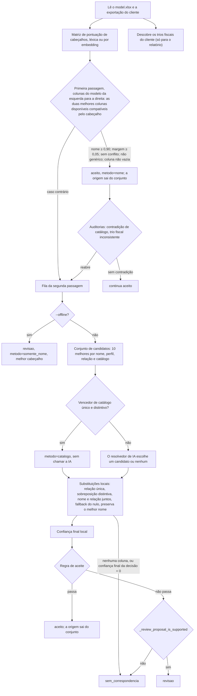

# Arquitetura

Como o mapeador de colunas decide, escrito para quem vai alterá-lo. O texto acompanha uma exportação do cliente desde a leitura até a planilha mapeada entregue, apresenta cada regra e cada limiar e termina com onde fazer as mudanças mais comuns.

Documentos relacionados: instalação e comandos no [README](../README.md), as planilhas de `data/` em [DATA.md](DATA.md), como pontuar uma mudança em [EVALUATION.md](EVALUATION.md) e o comportamento errado ou surpreendente em [KNOWN_ISSUES.md](KNOWN_ISSUES.md). Este documento descreve o que o código faz hoje; onde isso surpreende, ele aponta para o KNOWN_ISSUES.md em vez de repetir a análise.

## Sumário

- [Regras que toda mudança deve respeitar](#regras-que-toda-mudança-deve-respeitar)
- [Vocabulário](#vocabulário)
- [Visão geral do pipeline](#visão-geral-do-pipeline)
- [Língua e esquema dos arquivos](#língua-e-esquema-dos-arquivos)
- [Leitura das planilhas](#leitura-das-planilhas)
- [Leitura dos cabeçalhos](#leitura-dos-cabeçalhos)
- [Primeira passagem: aceites só pelo nome](#primeira-passagem-aceites-só-pelo-nome)
- [Segunda passagem: evidência e decisão](#segunda-passagem-evidência-e-decisão)
- [Modo offline](#modo-offline)
- [O relatório de mapeamento](#o-relatório-de-mapeamento)
- [Atribuição de etapas](#atribuição-de-etapas)
- [Catálogos de referência](#catálogos-de-referência)
- [Aplicação de um relatório](#aplicação-de-um-relatório)
- [Constantes](#constantes)
- [Onde fazer as mudanças mais comuns](#onde-fazer-as-mudanças-mais-comuns)

## Regras que toda mudança deve respeitar

- **O escopo é o algoritmo de correspondência**: ler cabeçalhos, combinar evidências, atribuir colunas. Interface, reaproveitamento do mapeamento anterior de um cliente e escalabilidade ou custo ficam deliberadamente de fora por enquanto.
- **Os quatro clientes de amostra são exemplos de referência, não o produto, e nunca um conjunto de treino.** datasul, oracle, sap_procosa e sap_terumo existem para aprender estratégias que se transferem; em produção virão muitos ERPs e layouts que ninguém viu. Nunca ajuste uma regra a um deles e nunca ramifique o código pelo nome de um cliente. Valide cada mudança deixando um cliente de fora: desenvolva-a em três clientes e confira no quarto. Os gabaritos são teste de regressão, nunca dado de treino.
- **Prefira evidência que se transfere** a um ERP desconhecido (a aritmética do tributo, as tabelas oficiais de códigos, os dígitos verificadores de CPF/CNPJ/NF-e) a mais vocabulário de cabeçalho. A parcela dos aceites apoiada nesse tipo de evidência é a métrica de generalização a aumentar (ver [Atribuição de etapas](#atribuição-de-etapas)).
- **A fabricação é a falha que importa.** Preencher uma coluna do modelo com um dado que o cliente não tem é muito pior do que deixá-la vazia; por isso a precisão do aceite vale mais do que o recall.
- **A cobertura parcial é o desenho.** O modelo base é um superconjunto deliberadamente grande: cada cliente traz só parte dele, a maioria das colunas do modelo fica vazia para um dado cliente e `sem_correspondencia` muitas vezes é a resposta certa. Nunca use 227 como denominador e nunca chame de "faltante", "lacuna" ou "incompleta" uma coluna que o cliente não tem. Ao citar resultados, diga os ENTREGUES antes dos encontrados.
- **O limiar de aceite de 0,90 fica.** As escolhas certas que ficam abaixo dele chegam ao cliente pelo parecer do revisor, não por uma constante menor (ver [O limiar de aceite](#o-limiar-de-aceite)).
- **`data/model.xlsx` é imutável por enquanto.**
- **O repositório contém dados reais de clientes** (CNPJ/CPF, chaves de acesso): é de uso interno. O que uma execução online envia à OpenAI está na nota de confidencialidade em [Escolha de uma coluna](#escolha-de-uma-coluna).

## Vocabulário

Os termos fiscais, do jeito que o código e este documento os usam:

| Termo | Uso aqui |
|---|---|
| NF-e, chave de acesso | A chave de acesso tem 44 dígitos e termina num dígito verificador (DV) módulo 11. |
| CNPJ, CPF | 14 e 11 dígitos, os dois com dois DVs no fim. |
| CFOP | 4 dígitos por item; alguns ERPs acrescentam um sufixo (`5102/AA`). |
| NCM | 8 dígitos. |
| CST, CSOSN | Situação tributária por tributo, com 2 ou 3 dígitos; CSOSN é a variante do Simples Nacional. |
| ICMS, IPI, PIS, COFINS, ISS | Os tributos sobre consumo de hoje; cada um é uma família de tributo para o código. |
| CBS, IBS, IS | Os tributos da reforma do consumo, em transição a partir de 2026. As colunas 1 a 28 do modelo base são quatro blocos de 7 colunas: CBS, IBSM, IBS e IS. |
| cClassTrib | Classificação tributária do IBS/CBS, com 6 dígitos. |
| ST | Substituição tributária. Nos cabeçalhos aparece como a palavra `ST`, que o código trata como qualificador do tributo. |
| base de cálculo, alíquota, valor do imposto | O trio fiscal: para um tributo num item, valor = base × alíquota. |
| isentas, outras, base reduzida | Valor isento, valor de outras (não tributadas) e base reduzida. |
| de-para | Tabela de correspondência de colunas. Os clientes escreveram três `de_para_*.xlsx` em `data/keys/`; os de datasul e oracle são os gabaritos, o de procosa não é (ver [DATA.md](DATA.md#de_para_procosaxlsx-não-é-gabarito)). |

O código continua em inglês (ver [Língua e esquema dos arquivos](#língua-e-esquema-dos-arquivos)). Os termos que este documento usa e o nome que cada um tem no código e no relatório:

| Termo | No código | No relatório |
|---|---|---|
| coluna do modelo, coluna do cliente | `model_column`, `client_column`, `ColumnRef` | `coluna_modelo`, `coluna_cliente` |
| situação: aceito, revisão, sem correspondência | `status`: `accepted`, `review`, `no_match` | `situacao`: `aceito`, `revisao`, `sem_correspondencia` |
| limiar de aceite | `MapperConfig.final_threshold` | `limiar_final` (`Metadados da Execução`) |
| margem | `name_margin` (medida na linha), `name_margin_threshold` (mínimo exigido) | `margem_nome`, `margem_minima_nome` (`Metadados da Execução`) |
| primeira e segunda passagem | as duas fases de `map_columns` | |
| etapa de evidência, trava | `mapping_steps.EVIDENCE_STEPS`, `mapping_steps.GUARDS` | `apoiado_por`, `decidido_por`, `vetado_por` |
| resolvedor de IA | `OpenAIDataResolver`, etapa `resolver` | etapa `resolvedor_ia` |
| parecer do revisor | `reviewer_status`: `correct`, `incorrect`, `no_mapping_exists` | `parecer_revisor`: `correto`, `incorreto`, `inexistente` |
| entregue, retido, encontrado, fabricação | no mapeval: `delivered_correct`, `withheld_correct`, `Outcome.CORRECT`, `Outcome.FABRICATED` | impressos pelo mapeval, nunca gravados |

## Visão geral do pipeline

```text
data/clients/<exportação>.xlsx ─┐
data/model.xlsx ────────────────┼─> invoice_mapper.py ─> relatório de mapeamento ─> pareceres do revisor ─> apply_invoice_mapping.py ─> <cliente>_mapped.xlsx
reference_data/ ────────────────┘   (duas passagens)     (4 abas, em português)     (no próprio relatório)  (copia os valores como estão)
                                                           │
                                                           └─> python -m mapeval  (pontua os relatórios contra data/keys/)
```

Um relatório gravado antes da tradução, no formato antigo em inglês, não é lido: os leitores o recusam e dizem como convertê-lo (ver [Relatórios do formato antigo](#relatórios-do-formato-antigo)).

| Arquivo | Papel | Símbolos principais |
|---|---|---|
| [`invoice_mapper.py`](../invoice_mapper.py) | CLI e o algoritmo inteiro: pontuação de cabeçalhos, evidências, as duas passagens, o relatório e as frases em português que ele grava | `map_columns`, `main`, `write_results` |
| [`reference_catalog.py`](../reference_catalog.py) | Carrega as tabelas oficiais de códigos, conferidas por checksum, e pontua uma coluna contra uma delas | `ReferenceCatalogs`, `expected_catalogs`, `best_catalog_evidence` |
| [`mapping_steps.py`](../mapping_steps.py) | Nomeia as etapas de evidência e as travas que o relatório cita | `EVIDENCE_STEPS`, `GUARDS`, `deciding_step`, `format_steps` |
| [`report_schema.py`](../report_schema.py) | Fronteira entre o vocabulário interno e o esquema em português dos arquivos: nomes de aba, cabeçalhos, valores, chaves de metadados, recusa do formato antigo e vírgula decimal | `COLUMNS`, `ENUMS`, `to_external_frame`, `to_internal_frame`, `check_header`, `find_sheet` |
| [`cli_ptbr.py`](../cli_ptbr.py) | `ArgumentParser` com a ajuda e os erros do argparse em português, usado por todas as CLIs | `PortugueseArgumentParser` |
| [`apply_invoice_mapping.py`](../apply_invoice_mapping.py) | Monta a planilha no layout do modelo a partir de uma exportação, de um relatório e dos pareceres do revisor | `build_mapped_workbook`, `_effective_columns` |
| [`update_reference_data.py`](../update_reference_data.py) | Reconstrói `reference_data/`; baixa de sites do governo | `official_frames`, `static_frames`, `write_snapshot` |
| [`mapeval/`](../mapeval) | Pontua os relatórios arquivados contra os gabaritos | ver [EVALUATION.md](EVALUATION.md) |

## Língua e esquema dos arquivos

O código pensa em inglês; tudo o que uma pessoa lê sai em português. `report_schema.py` é a única fronteira entre os dois, e o que é entrada dos modelos de IA não atravessa essa fronteira: fica em inglês, byte a byte.

### O que fica em inglês e o que sai em português

- **Em inglês**: identificadores Python, nomes de módulo e de arquivo, nomes de pasta (`data/clients`, `data/reports`, ...), nomes dos arquivos gerados (`mapping_<cliente>_full.xlsx`, o padrão `mapping_<nome do arquivo do cliente>.xlsx`, `<cliente>_mapped.xlsx`), flags de CLI (`--offline`, `--output`, ...), ids de catálogo em `reference_data/` (manifesto, nomes dos CSVs e checksums não mudaram), nomes das funções de teste e as fixtures de cabeçalhos em inglês dos testes. Em memória, os valores de máquina também são internos: `status == "accepted"`, ids de etapa como `semantic`, `ColumnRef.display_name` com `(occurrence N)`.
- **Em português**: nomes de aba, cabeçalhos, valores enumerados, ids de etapa e de trava, chaves e sentinelas dos metadados, o sufixo de ocorrência e `Coluna sem nome N` nas células, todas as frases que o mapeador escreve, as mensagens, a ajuda e os erros das CLIs, os comentários e as docstrings.
- **Intacto, na língua em que foi escrito**: a justificativa que a IA escreve (o prompt é inglês, então a IA responde em inglês: são 502 justificativas nos quatro relatórios arquivados, e as futuras também virão em inglês), as 26 observações do revisor de sap_procosa, os dados do cliente, os cabeçalhos do modelo e os valores de amostra.

Como o mesmo dado aparece em cada lado:

| O quê | Em memória | No arquivo |
|---|---|---|
| aba de mapeamentos | | `Mapeamentos` (no formato antigo: `Mappings`) |
| cabeçalho | `final_confidence` | `confianca_final` |
| situação | `accepted` | `aceito` |
| método | `name_only` | `somente_nome` |
| etapas | `semantic + catalog` | `semantico + catalogo` |
| trava | `vacuity` | `coluna_vazia` |
| nome de exibição | `Descrição (occurrence 2)` | `Descrição (ocorrência 2)` |
| coluna sem cabeçalho | `Unnamed column 7` | `Coluna sem nome 7` |
| chave de metadados | `client_sha256` | `sha256_cliente` |
| sentinela de metadados | `disabled` | `desativado` (`offline` fica `offline`) |
| catálogo | `ibs_cbs_classification` | `cclasstrib` |

### `report_schema`: a única fronteira

`report_schema.py` guarda as tabelas de nomes e as conversões, mais os auxiliares descritos abaixo: `SHEETS` (e `LEGACY_SHEETS`, os nomes de aba do formato antigo, só para recusá-los), `COLUMNS` (cabeçalhos por tabela, na ordem gravada), `METADATA_KEYS` e `METADATA_SENTINELS`, `STEP_IDS`, `GUARD_IDS` e `LEGACY_STEP_IDS`, `ENUMS`, `TEXT_LABELS` (rótulos usados dentro de frases) e `FIELD_KIND`, que diz como cada célula é tratada (enum, frase fixa, etapas, sinais, nome de exibição ou texto livre). Ele não tem modelos de frase e não importa `invoice_mapper` nem `apply_invoice_mapping`, para que os dois possam importá-lo sem ciclo (`test_the_boundary_modules_import_nothing_from_the_mapper`).

**Quem grava** mantém tudo interno em memória e converte na gravação. `invoice_mapper.write_results` passa cada aba por `to_external_frame` e os metadados por `to_external_metadata`; o `apply` monta o entregável com `sheet_name`, `header_label` e `external_value`. O texto livre passa intacto pela fronteira, porque já chega escrito na língua certa.

**Quem lê** só aceita o esquema em português e converte para o vocabulário interno antes de qualquer comparação:

- `check_header(header, table)` confere o cabeçalho de cada tabela: ele precisa ter a coluna da tabela (na aba de mapeamentos, `numero_coluna_modelo`) e nenhum cabeçalho do formato antigo, em inglês.
- `to_internal_frame` (pandas, usado pelo `apply`) e `internal_header_index` (linhas do openpyxl, usado pelo mapeval) conferem o cabeçalho e o renomeiam para os nomes internos; `internal_value` converte os valores. Um enum só volta ao interno quando o valor em português é exato; etapas, sinais e nomes de exibição voltam pela forma em português (`display_name_to_internal` reconhece `(ocorrência N)` e `(ocorrencia N)`, em qualquer caixa). Um valor desconhecido passa como está.
- O parecer do revisor é a exceção: passa pela fronteira como foi digitado, e o `apply` o valida com `normalize_reviewer_status`, que ignora caixa, acentos e espaços nas pontas, só reconhece `correto`, `incorreto` e `inexistente` e devolve `None` para qualquer outro valor, inclusive os pareceres em inglês do formato antigo. Como eles coincidem com os valores internos (`correct`...), só essa recusa explícita impede que passem calados.
- `find_sheet(sheet_names, kind)` localiza uma aba comparando sem caixa, acentos e espaços nas pontas, e devolve o nome como está na pasta de trabalho.
- `internal_metadata` lê a aba de metadados e converte as chaves e os sentinelas em português.

**O formato antigo é recusado** com `ValueError`. Quando a aba de mapeamentos está no formato antigo (a aba se chama `Mappings`, ou o cabeçalho tem nomes em inglês e não tem `numero_coluna_modelo`), a mensagem diz que o relatório está no formato antigo, em inglês (versão 2 do esquema), e como convertê-lo com o `migrate_reports.py` do commit `5fe5092` (ver [Relatórios do formato antigo](#relatórios-do-formato-antigo)). Um nome do formato antigo dentro de um relatório em português (uma aba `Run Metadata`, um cabeçalho `reviewer_status`, uma chave `client_sha256`) é recusado com o que renomear (`'reviewer_status' para 'parecer_revisor'`). Lido pela metade, um relatório assim faria a verificação de hash ser pulada ou os pareceres do revisor serem ignorados sem aviso.

Os leitores são o `apply` (`_read_mapping_report`, `_run_metadata`) e o mapeval (`mapeval.score.read_mappings`).

`MAPPING_SCHEMA_VERSION` é 3 no esquema em português (`report_schema.SCHEMA_VERSION_PT`); o formato antigo é 2 (`SCHEMA_VERSION_LEGACY`). Um relatório migrado, como os quatro arquivados, leva `versao_esquema_mapeamento` = 3 e a chave extra `migrado_da_versao_esquema` = 2, com o `gerado_em_utc` original.

**Mudança incompatível no entregável.** A planilha mapeada também sai em português: abas `Dados Mapeados` e `Cobertura` (antes `Mapped Data` e `Coverage`), célula A1 `__info_mapeamento__` (antes `__mapping_info__`), rótulos e valores. Qualquer leitor a jusante que procure os nomes antigos precisa ser atualizado. O que mudou e o que ficou igual (a posição dos dados, a partir da linha 23, não mudou) está em [DATA.md](DATA.md#planilhas-mapeadas-datamapped).

### Frases escritas em português na origem

As frases para pessoas não são traduzidas na gravação: elas são escritas em português no lugar em que são montadas. As frases fixas do relatório são constantes de módulo em `invoice_mapper.py`:

| Constantes | Coluna |
|---|---|
| `REASON_NO_UNUSED`, `REASON_PASS_ONE_ACCEPTED`, `REASON_OFFLINE`, `REASON_DATA_ERROR`, `REASON_CATALOG_DECISION`, `REASON_UNIQUE_RELATIONSHIP`, `REASON_OVERLAP`, `REASON_JOINT`, `REASON_NULL_FALLBACK`, `REASON_PRESERVE_BEST`, `REASON_UNSUPPORTED_NO_MATCH`, `REASON_CONFLICT_REVIEW`, `REASON_CONTRADICTION`, `REASON_AMBIGUOUS_EMPTY`, `REASON_VACUITY` | `justificativa` |
| `PROOF_TEXT`, `PROOF_NOT_DECISIVE_SUFFIX` | `prova_aritmetica` |
| `SIGNAL_TRIO`, `SIGNAL_CATALOG`, `SIGNAL_CHECKDIGIT`, `SIGNAL_DATES`, `SIGNAL_EMPTY`, `SIGNAL_ALL_ZERO`, `SIGNAL_NO_SIGNAL` | `detalhe_sinais` |
| `WHY_HELD_BELOW_THRESHOLD`, `WHY_HELD_NAME_ONLY`, `WHY_HELD_VACUOUS` | `motivo_retencao` |
| `RESOLVER_DISAGREES` | `divergencia_ia` |
| `HEADER_CONFLICT_FAMILY_PT`, `HEADER_CONFLICT_QUALIFIER_PT`, `HEADER_CONFLICT_ROLE_PT` | dentro de `REASON_CONFLICT_REVIEW` e nas mensagens do `apply` |

As mensagens, a ajuda e os erros ficam escritos em português no módulo que os usa, em geral no próprio ponto de uso.

Números dentro de frases usam vírgula decimal, por `report_schema.format_decimal_br` (`0.998` vira `0,998`) e `format_percent_br` (`0.882` vira `88,2%`), com os mesmos dígitos que a frase em inglês mostrava. As células numéricas continuam numéricas. Os rótulos que entram nas frases (papel do cabeçalho, qualificador do tributo, posição no trio, tipo de DV, nome do catálogo) vêm de `report_schema.TEXT_LABELS`.

A prova aritmética que não distingue a coluna termina com o marcador `report_schema.PROOF_NOT_DECISIVE_PT` (`"não distingue esta coluna"`). `report_schema.proof_is_decisive` reconhece esse marcador, e é o que `_supporting_step_ids` e o mapeval usam para decidir se a prova conta como evidência aritmética.

As CLIs usam `cli_ptbr.PortugueseArgumentParser`, que traduz os textos fixos do argparse (`uso:`, títulos das seções, ajuda de `-h`, mensagens de erro) só enquanto um método do próprio parser está rodando; nenhum outro parser do processo muda de língua. As flags continuam em inglês e os metavars são português em ASCII (`EXPORTACAO`, `RELATORIO`, `ARQUIVO`, `DIRETORIO`, ...). A saída também é em português: o mapeador imprime `aceito=... revisao=... sem_correspondencia=...`, o `apply` imprime `colunas_mapeadas=...` e o mapeval imprime a linha `TOTAL COM GABARITO`. No mapeador e no `apply`, um arquivo ausente sai como `Arquivo não encontrado: ...`, com código de saída 1; o mapeval ainda mostra o traceback do Python, em inglês, inclusive diante de um relatório do formato antigo (a última linha traz a mensagem em português, com o caminho da conversão).

### Entrada dos modelos: inglês, byte a byte

O que vai para a OpenAI não foi traduzido e não pode ser: qualquer alteração pode mudar as pontuações e as decisões online, e nenhum teste offline comum perceberia (por isso existe o teste dourado descrito abaixo):

- o prompt do resolvedor (`instructions` em `OpenAIDataResolver.resolve`);
- o prefixo do embedding, `"Brazilian invoice spreadsheet column: {header}"` (`OpenAIEmbeddingHeaderScorer._embeddings`);
- o esquema de saída `DataMappingDecision`, com os nomes e as descrições dos campos;
- o payload do resolvedor, chaves e valores;
- o texto de `semantic_header_conflict`, que vai no payload;
- `ColumnRef.name` (`Unnamed column N` para cabeçalho em branco) e `ColumnRef.display_name` (`(occurrence N)`).

Quando um desses textos também precisa ser mostrado a uma pessoa, a versão em português é calculada das mesmas entradas estruturadas, nunca traduzindo o inglês em memória. O caso principal é o conflito de cabeçalhos: `_header_conflict_parts(left, right)` devolve `(tipo, lado esquerdo, lado direito)`, e dele saem as duas descrições.

| Função | Para quem | Exemplo (`Valor ICMS` × `Valor ICSP`) |
|---|---|---|
| `semantic_header_conflict` | a IA, no payload | `tax-family conflict (icms vs icsp)` |
| `describe_header_conflict_pt` | pessoas: `REASON_CONFLICT_REVIEW` e o erro do `apply` | `conflito de família de tributo (ICMS vs ICSP)` |

Como as duas saem da mesma análise, a descrição em português existe exatamente quando a inglesa existe e aponta o mesmo tipo de conflito. Os nomes de coluna seguem a mesma ideia: em memória ficam em inglês, e `report_schema.display_name_to_external` escreve `Coluna sem nome 7` e `Descrição (ocorrência 2)` só nas células gravadas.

O teste [`tests/test_model_input_golden.py`](../tests/test_model_input_golden.py) garante isso. Com clientes falsos da OpenAI, ele registra o prompt, o esquema de saída, as entradas do embedding (com um cabeçalho em branco e cabeçalhos repetidos), os argumentos de `responses.parse` em chamadas a `OpenAIDataResolver.resolve` (com os três tipos de conflito, coluna sem nome, segunda ocorrência, evidência de catálogo e aritmética) e todas as chamadas e decisões de uma execução pequena de `map_columns`, e compara tudo com `tests/fixtures/model_input_golden.json`, capturado no código anterior à tradução (commit `2ae4b6d`). Se ele falhar, o que os modelos recebem mudou.

Consequência: a justificativa que a IA escreve (`DataMappingDecision.reason`) chega em inglês e é gravada como veio, ao lado das frases em português do mapeador.

### Relatórios do formato antigo

Os relatórios gravados antes da tradução estão no formato antigo, em inglês (versão 2 do esquema), com as frases do mapeador em inglês. Os quatro de `data/reports/` foram convertidos para o esquema em português no commit `09ebda9` pelo `migrate_reports.py`, sem reexecutar o mapeador, e as planilhas de `data/mapped/` foram regeneradas a partir deles. Nenhuma decisão mudou: as contagens por situação, os 26 pareceres e as 26 observações de sap_procosa, as 502 justificativas da IA e os números do mapeval são os mesmos de antes; sap_procosa manteve o layout antigo, com duas abas. O que a conversão fez está em [DATA.md](DATA.md#migração-dos-relatórios-arquivados).

Com a conversão feita, o `migrate_reports.py`, o `legacy_reports.py` (que reescrevia em português as frases do mapeador) e o `backfill_mapping_steps.py` (que acrescentou as colunas de etapas aos relatórios gravados antes delas) saíram do repositório depois do commit `5fe5092`, junto com a leitura do formato antigo. Hoje um relatório antigo é recusado pelos leitores (ver [`report_schema`: a única fronteira](#report_schema-a-única-fronteira)), e a mensagem diz como convertê-lo com o `migrate_reports.py` daquele commit; os comandos estão no [README](../README.md#comandos-do-dia-a-dia).

## Leitura das planilhas

`SheetTable.from_excel` lê uma aba com `header=None, dtype=object`, então cada célula fica com o valor que o leitor de Excel produziu, sem conversão de tipo por coluna. Quem precisa de um número o interpreta na hora (`_numeric_value` entende `1.234,56`, sinal de menos no fim e negativos entre parênteses); nada reescreve os dados.

- A linha de cabeçalho vem de `--model-header-row` / `--client-header-row` (contada a partir de 1; padrão 1). Toda linha abaixo dela é dado.
- Um cabeçalho em branco vira `Unnamed column N` em memória; nas células do relatório ele aparece como `Coluna sem nome N`.
- Cabeçalhos iguais depois de `normalize_header` recebem um contador de ocorrência: o segundo `Descrição` é `Descrição (occurrence 2)` em memória (`ColumnRef.display_name`) e `Descrição (ocorrência 2)` nos arquivos. O relatório identifica uma coluna do cliente pelo número (a partir de 1) mais esse nome de exibição.
- `data/model.xlsx` tem 209 linhas de amostra abaixo do cabeçalho. Elas importam: a segunda passagem monta o perfil de cada coluna do modelo a partir delas.

## Leitura dos cabeçalhos

### Normalização e assinatura semântica

`normalize_header` tira os espaços das pontas, reduz o texto a ASCII (NFKD, sem acentos), passa para minúsculas e troca cada sequência de caracteres não alfanuméricos por um espaço.

`semantic_header_signature` transforma isso num conjunto de tokens:

1. Reescritas de expressão. `tax situation` e `situacao tributaria` viram `cst`. `(valor|vlr|val|vl) contab…` vira `valor total nf`: nos livros fiscais, "valor contábil" é o total do documento, e exigir a palavra de valor deixa de fora `Conta Contábil` e `Data Contábil`.
2. As stopwords de `_HEADER_STOPWORDS` são descartadas (artigos e preposições em português e inglês, mais `44` e `digit`).
3. Os tokens passam por `_HEADER_TOKEN_ALIASES` (52 entradas) para uma forma única em português: `vlr`/`val`/`value` → `valor`, `aliq`/`alq`/`rate`/`taxa` → `aliquota`, `nr`/`num`/`no`/`number` → `numero`, `invoice` → `nota`, e assim por diante.
4. Só quando `cst` está presente, `pi` vira `pis`.

Dois cabeçalhos com assinaturas iguais e não vazias são semanticamente equivalentes (`semantically_equivalent_headers`). A ordem das palavras não importa, porque a assinatura é um conjunto: `Vlr Contabil` e `Valor Total NF` dão os dois `{nf, total, valor}`.

### A pontuação de nome

Os dois avaliadores devolvem uma matriz modelo × cliente com valores entre 0 e 1. `map_columns` a calcula uma vez por execução.

| | `LexicalHeaderScorer` (offline) | `OpenAIEmbeddingHeaderScorer` (online) |
|---|---|---|
| Pontuação básica | 0,7 × razão do `SequenceMatcher` entre os textos normalizados + 0,3 × Jaccard das assinaturas | Similaridade de cosseno dos vetores do `text-embedding-3-large` para `"Brazilian invoice spreadsheet column: {header}"`, limitada ao intervalo de 0 a 1. Cabeçalhos do modelo e do cliente vão em chamadas separadas, sem repetição, 512 por requisição. |
| Texto normalizado idêntico | 1,0 | 1,0 |
| Assinaturas iguais | no mínimo `SEMANTIC_EQUIVALENCE_SCORE` = 0,98 | no mínimo 0,98 |
| Etapa no relatório | `lexico` (interno `lexical`) | `semantico` (interno `semantic`) |

Assinaturas iguais passam, portanto, do limiar de nome de 0,90, e o 1,0 fica reservado para texto idêntico. Medido com o avaliador léxico: `Valor Total NF` contra `Vlr Contabil` dá 0,98; contra `Conta Contabil`, 0,20. `map_columns` registra a etapa de cabeçalho como `lexical` quando o avaliador é um `LexicalHeaderScorer` e como `semantic` para qualquer outro, inclusive os dublês dos testes.

### Famílias de tributo, papéis e palavras de papel truncadas

As travas e a aritmética precisam saber de qual tributo um cabeçalho fala e qual posição ele nomeia.

- **Família.** `header_tax_families` cruza a assinatura, depois de `_TAX_FAMILY_ALIASES` (`cof`/`cofi` → `cofins`, `fcp` → `fecp`, `ibss` → `ibs`), com os 16 nomes de `_TAX_FAMILIES`: cbs, cofins, csll, fecp, icap, icep, icms, icsp, ibs, ibsm, inss, ipi, irpj, iss, iva, pis. Um tributo fora da lista não tem família. Os blocos IS e DIF_ALIQ do modelo e um `ICM` truncado não têm nenhuma, então nem a trava de família nem o escopo aritmético se aplicam a eles (ver o item [3.9 de KNOWN_ISSUES.md](KNOWN_ISSUES.md#39-icm-is-e-dif_aliq-não-são-famílias-de-tributo)).
- **Papel.** `header_semantic_role` devolve o primeiro papel que casar, nesta ordem: `tax_classification`, `tax_status`, `rate`, `other`, `exempt`, `reduced_base`, `base`, `value`, `tax_group`, `product_group`, `tax_rule`, `text`, `unit_of_measure`, `unit_price`, `nfe_key`, `party_tax_id`, `regional_tax_id`, `item_id`, `document_id`, ou `None`. Dois refinamentos: uma leitura de alíquota que se apoia só numa abreviação como `aliq` cede a uma palavra de posição explícita (`DIF_ALIQ Base` é base, enquanto `Tax rate (Tax/Base)` continua alíquota), e `Mont.`/`Montante` significa base dentro de um cabeçalho com família de tributo e valor fora dele. Os papéis são vocabulário interno (também chegam à IA); nas frases para pessoas eles aparecem pelos rótulos de `report_schema.TEXT_LABELS["header_role"]` (`base de cálculo`, `alíquota`, ...).
- **Palavras de papel truncadas.** Os ERPs cortam os cabeçalhos, então a palavra de papel costuma chegar como `Isen`, `Outr` ou `Red`. `expand_truncated_role_words` acrescenta a palavra inteira para um token que seja prefixo, com pelo menos `_MIN_ROLE_PREFIX` = 3 caracteres, de exatamente um conceito de `_ROLE_CONCEPT_WORDS` (outras, isentas, reduzida). O índice resultante, `_ROLE_PREFIXES`, tem 21 prefixos. A expansão só acrescenta tokens, nunca substitui. `test_the_role_vocabulary_is_prefix_unambiguous` falha se uma palavra nova fizer algum prefixo alcançar dois conceitos.
- **Escopo.** `tax_calculation_scope` devolve `(família, qualificadores)` para a aritmética: exatamente uma família, mais qualquer um de `st`, `icop`, `dif`, `diferencial`. Um cabeçalho que nomeia duas famílias (`Base ICMS_FECP`) não tem escopo. O modelo tem 14 escopos com uma coluna de base, uma de alíquota e uma de valor cada.

### Travas

Uma trava é um motivo para recusar um aceite. A primeira passagem recusa diante de qualquer uma delas; a segunda as trata de forma um pouco diferente (ver [O limiar de aceite](#o-limiar-de-aceite)).

| Trava (interno) | No relatório | Função | Dispara quando |
|---|---|---|---|
| `family_conflict` | `conflito_tributario` | `semantic_header_conflict` | Os dois cabeçalhos nomeiam famílias de tributo e elas são disjuntas (ICMS × ICSP); ou têm uma família em comum, mas só um diz `ST`; ou os dois têm papel e os papéis diferem (base × valor). Um cabeçalho sem família ou sem papel nunca conflita. |
| `underspecified` | `cabecalho_generico` | `underspecified_header_match` | A assinatura do cliente é um único token e um subconjunto estrito de uma assinatura do modelo com vários tokens (`Centro` para `Centro custo`). |
| `vacuity` | `coluna_vazia` | `client_column_is_vacuous` | A coluna do cliente não tem nenhuma célula preenchida. Uma coluna de zeros não é vazia: zero é dado fiscal comum. |
| `exclusivity` | `coluna_ja_consumida` | o conjunto `available` em `map_columns` | A coluna do cliente já foi consumida por um aceite. |

## Primeira passagem: aceites só pelo nome

`map_columns` percorre as colunas do modelo da esquerda para a direita. Para cada uma, `_rank_header_compatible` ordena pela pontuação de nome as colunas do cliente ainda em `available`, descarta as que têm conflito de cabeçalho (a menos que todas tenham) e fica com as duas primeiras. O par é **aceito** quando tudo isto vale:

- pontuação de nome ≥ `name_threshold` (0,90);
- vantagem sobre a segunda coluna compatível ≥ `name_margin_threshold` (0,05);
- nenhum `semantic_header_conflict`;
- não é `underspecified_header_match`;
- a coluna do cliente não é vazia.

Um aceite recebe `method="name"` (gravado `metodo` = `nome`) e `final_confidence` igual à pontuação de nome. Se um trio fiscal descoberto puser esta coluna do cliente nesta posição, ele recebe também uma `prova_aritmetica` (ver a descoberta de trios em [Evidência](#evidência)). A coluna do cliente sai de `available`. Toda outra coluna do modelo entra na fila da segunda passagem. Se não sobrar nenhuma coluna do cliente, a linha fica `sem_correspondencia` na hora.

A ordem importa. Uma origem aceita sai do conjunto, então uma coluna do modelo mais à esquerda tem prioridade sobre um cabeçalho, e a margem de uma coluna posterior é medida só contra o que sobrou. Um segundo colocado em conflito não bloqueia o aceite, porque as colunas em conflito são retiradas da ordenação antes.

### Auditorias que reabrem aceites da primeira passagem

Duas verificações rodam entre as passagens. Cada uma pode desfazer um aceite, devolver a coluna do cliente a `available` e pôr a coluna do modelo na fila da segunda passagem.

1. **`_audit_accepted_catalog_matches`.** Para cada aceite cujo cabeçalho do modelo aponta para um catálogo (ver [Catálogos de referência](#catálogos-de-referência)), pontua a coluna do cliente e grava na linha `nome_catalogo`, `cobertura_catalogo`, `cobertura_distinta_catalogo` e `confianca_catalogo`. Reabre o aceite diante de uma contradição clara: o catálogo tem especificidade ≥ 0,90 (CFOP, NCM, IBGE), a coluna tem pelo menos 5 valores, pelo menos 90% deles são códigos bem formados, mas menos de 10% das linhas têm um código válido, e os códigos válidos não são todos zeros.
2. **`_demote_inconsistent_tax_header_matches`.** Para cada escopo de tributo cujas base, alíquota e valor foram todos aceitos, testa valor = base × alíquota nessas colunas. Se a pontuação não chegar a 0,90, tenta, posição por posição, cada coluna informativa disponível que pontuaria pelo menos 0,90 naquela posição. Se essas colunas existirem e a melhor troca melhorar a pontuação da posição em pelo menos 0,50, a posição é reaberta; se existirem mas nenhuma melhorar tanto, nada é reaberto. Se nenhuma existir e o trio atual for uma contradição forte (pelo menos 20 linhas testadas, cobertura de pelo menos 0,80, aderência de no máximo 0,20), reabre-se a posição com a pontuação de nome mais fraca. No máximo uma posição por escopo é reaberta.

## Segunda passagem: evidência e decisão

A segunda passagem visita as colunas do modelo da fila em ordem crescente de número. Um aceite da segunda passagem também consome a origem e também vira âncora para a aritmética das colunas seguintes.

### Perfis e o conjunto de candidatos

`summarize_values` monta o perfil de uma coluna: contagens, tipo inferido, frações numérica, de dígitos e de letras, estatísticas de comprimento e de quantidade de dígitos, quantis numéricos, a fração de valores com DV válido de CPF, CNPJ e chave de acesso, uma `evidence_quality` igual a `empty`, `all_zero` ou `informative`, e até `sample_size` (8) valores de amostra. `sample_values` pega os dois valores mais frequentes e depois valores espalhados por igual entre os valores distintos ordenados, cada um cortado em 100 caracteres, de modo que a escolha não depende da ordem das linhas.

O **perfil da coluna-alvo é montado com as próprias linhas de amostra da coluna em `data/model.xlsx`**, não com dados de um cliente. No modelo atual, 93 colunas têm amostras informativas, 87 só têm zeros e 47 estão vazias. Nos dois últimos grupos, as evidências de perfil, de sobreposição e de identificador descritas abaixo não podem disparar; as evidências de catálogo e aritmética leem só dados do cliente e continuam podendo.

O conjunto de candidatos de um alvo:

- **Online** (`_rank_name_and_profile_candidates`): a união das `candidate_count` (10) melhores colunas disponíveis por pontuação de nome, por `profile_similarity` (só pontuações > 0), por pontuação de relação (> 0) e por pontuação de catálogo (> 0). No máximo 40 colunas, ordenadas pela pontuação de nome.
- **Offline** (`_rank_available`): as 10 melhores por pontuação de nome.

### Evidência

**Aritmética de relação** (só online). `_candidate_relationship_evidence` se aplica quando o alvo é uma coluna de base, alíquota ou valor com escopo de tributo e as outras duas posições desse escopo já estão *aceitas*. Cada candidato é posto na posição aberta e pontuado por `tax_calculation_evidence`. O mesmo vale para quantidade × preço unitário = valor do item (`line_calculation_evidence`; no modelo, `Quantidade`, `Preço líq.` e `Valor Total do Item`).

`tax_calculation_evidence` usa as linhas com base ≠ 0 e alíquota ≠ 0 ou |valor| > 0,02, e precisa de pelo menos 5 dessas linhas com os três números. Testa a alíquota como porcentagem (18) e como fração (0,18) e fica com o melhor encaixe. Uma linha encaixa quando o erro é de no máximo 0,02 em valor absoluto ou 2% em valor relativo (3% na identidade do item). Então:

```text
score = fit × √coverage × min(1, √(rows / 20)) × (0.75 se base ou valor tiver menos de 3 valores distintos, senão 1)
```

`_relationship_is_strong_contradiction` marca uma relação testada em pelo menos 20 linhas, com cobertura de pelo menos 0,80 e aderência de no máximo 0,20.

**Descoberta de trios fiscais** (só para o relatório). `discover_client_tax_trios` roda uma vez, antes da primeira passagem, só sobre as colunas do cliente: sem modelo, sem aceite anterior. Agrupa as colunas do cliente por escopo e papel, testa cada combinação base × alíquota × valor e guarda cada uma que não seja degenerada e tenha aderência ≥ `TRIO_MIN_FIT` (0,97) em pelo menos `TRIO_MIN_ROWS` (30) linhas. Cada trio registra `alternatives`, o número de blocos disjuntos para o seu escopo, porque um cliente pode ter dois blocos separados do mesmo tributo que satisfazem a identidade. `trio_corroboration` procura um trio cuja posição para o papel da coluna do modelo seja a coluna do cliente escolhida, e `_trio_proof_text` escreve a frase da `prova_aritmetica` (`PROOF_TEXT`), acrescentando `PROOF_NOT_DECISIVE_SUFFIX`, que termina em "não distingue esta coluna", quando há mais de um bloco. Os trios descobertos alimentam `prova_aritmetica`, `apoiado_por`/`decidido_por` e a aba `Colunas do Cliente sem Uso`. **Eles não alimentam a regra de aceite**; só a evidência de relação ancorada, descrita acima, alimenta.

**Evidência de catálogo** (nos dois modos). `_candidate_catalog_evidence` pontua cada coluna disponível do cliente contra cada catálogo que `expected_catalogs(cabeçalho do modelo)` indica, com cache por (catálogo, coluna). A pontuação e a regra de distintividade estão em [Catálogos de referência](#catálogos-de-referência).

**Sobreposição de amostras.** `_distinctive_samples` fica com os valores de amostra que dificilmente coincidem por acaso: valores só de dígitos precisam de pelo menos 6 dígitos, os outros de pelo menos 4 caracteres (3 se misturam letras e dígitos), e zeros são descartados. `distinctive_sample_overlap` é compartilhados / min(tamanhos dos conjuntos) e `distinctive_sample_overlap_count` é a quantidade compartilhada. Dois ou mais valores compartilhados dão `overlap_score = min(0.99, 0.90 + 0.09 × overlap)`.

**Formato dos valores.** `profile_similarity` é 0 a menos que os dois perfis sejam informativos; caso contrário, é uma soma ponderada: 0,55 para a sobreposição dos conjuntos de quantidade de dígitos, 0,15 para o mesmo tipo inferido, 0,10 para a mediana da quantidade de dígitos e 0,05 cada para as frações numérica, de dígitos e de letras e para o comprimento mediano. Ela pode trazer uma coluna para o conjunto de candidatos, mas na pontuação é limitada a 0,84, então nunca aceita um mapeamento sozinha.

**Dígitos verificadores de identificadores.** `_cpf_is_valid`, `_cnpj_is_valid` e `_nfe_key_is_valid` implementam o DV módulo 11 sobre os dígitos de um valor. `identifier_match_score` é min(fração do alvo, fração do candidato) para um tipo de identificador em que os dois lados têm pelo menos 80% de valores válidos. Como o lado do alvo são as linhas de amostra do modelo, duas colunas do modelo se qualificam hoje: `Nº ID fiscal 1` (CPF) e `Chave de acesso` (chave de acesso da NF-e). Os validadores exigem o comprimento exato, então um CPF ou CNPJ gravado como número, que perdeu o zero à esquerda, falha (ver o item [3.8 de KNOWN_ISSUES.md](KNOWN_ISSUES.md#38-o-dv-de-cpfcnpj-falha-em-células-numéricas)).

### Escolha de uma coluna

1. **Decisão local por catálogo.** `_unique_distinctive_catalog_decision` olha os candidatos cuja melhor evidência de catálogo passa em `catalog_evidence_is_distinctive`. Se o primeiro tiver vantagem de pelo menos 0,10 sobre o seguinte, ele é escolhido com `method="catalog"` (gravado `catalogo`) e a IA não é chamada.
2. **Resolvedor de IA.** Caso contrário, `OpenAIDataResolver.resolve` faz uma chamada à Responses API da OpenAI (`client.responses.parse`, modelo `gpt-4o-mini` por padrão, `temperature=0`, `store=False`). A saída estruturada é `DataMappingDecision`: o `client_column_id` de um candidato ou null, uma `data_confidence`, uma `final_confidence` e uma `reason` de uma frase.
   - **Entrada**: o nome e o perfil da coluna do modelo (de `data/model.xlsx`) e, para cada candidato, id, nome, número da coluna, pontuação de nome, texto do conflito de cabeçalho, `profile_similarity`, `distinctive_sample_overlap`, evidência de relação, evidência de catálogo e o perfil completo com até 8 valores de amostra. Tudo em inglês (ver [Entrada dos modelos](#entrada-dos-modelos-inglês-byte-a-byte)).
   - **Instruções** (versionadas por `PROMPT_VERSION`, hoje `2026-08-04.2`): os nomes continuam sendo a evidência principal; semelhança numérica genérica não é evidência; a maioria dos campos do modelo legitimamente não está numa exportação do cliente, então null é uma resposta normal; como ler cada campo de evidência.
   - Dentro de `resolve`, quando as linhas de um dos lados estão vazias ou só têm zeros, a confiança final devolvida sobe para no mínimo a pontuação de nome da coluna escolhida.
   - Qualquer exceção vira uma linha `revisao` no melhor cabeçalho, com `metodo` = `erro_dados` e a justificativa `REASON_DATA_ERROR`, e a execução continua (ver o item [3.1 de KNOWN_ISSUES.md](KNOWN_ISSUES.md#31-falhas-da-api-viram-linhas-em-revisão-e-a-execução-sai-com-0)).

**A IA escolhe; ela não decide.** A `data_confidence` e a `final_confidence` dela são gravadas como `confianca_dados_ia` e `confianca_final_ia` para auditoria e nunca entram na `confianca_final` nem na regra de aceite. Fora essa cópia de auditoria, as confianças do objeto de decisão importam em exatamente dois pontos: uma decisão com `final_confidence` 0 vira `sem_correspondencia`, e a `data_confidence` dela é uma das condições do fallback do nulo, abaixo. Todo o resto é decidido localmente. Quando a linha usa a `reason` da IA como justificativa, ela é gravada em inglês, como veio.

**Confidencialidade.** O repositório contém dados reais de clientes (CNPJ/CPF, chaves de acesso). Uma execução online envia todos os cabeçalhos do modelo e do cliente para o endpoint de embeddings e, para cada alvo da segunda passagem que o catálogo não resolve, valores de amostra da coluna do modelo e de até 40 colunas do cliente, sem anonimizar. `store=False` pede à OpenAI que não guarde as respostas. Confirme que o cliente permite isso antes de rodar online; `--offline` não envia nada. A chave é lida de `OPENAI_API_KEY` no ambiente; nenhum código carrega `.env`.

### Substituições locais, em ordem

Rodam sobre a coluna escolhida pela decisão por catálogo ou pela IA:

1. **Relação única.** Entre os candidatos sem conflito, se a melhor pontuação de relação for de pelo menos `final_threshold` (0,90) e tiver vantagem de pelo menos 0,10 sobre a seguinte, essa coluna é escolhida (`metodo` = `dados`).
2. **Sobreposição distintiva**, só se a 1 não disparou. O candidato que compartilha mais amostras distintivas é escolhido quando compartilha pelo menos 2, supera o segundo colocado em quantidade ou em sobreposição, tem sobreposição maior que a da escolha atual e sua pontuação de nome não fica mais de 0,10 abaixo da escolha atual (ou sua sobreposição é de pelo menos 0,50). Aqui os conflitos de cabeçalho não são filtrados.
3. **Nome e relação juntos.** Se a relação da coluna escolhida for de pelo menos 0,90 e 0,4 × nome + 0,6 × relação for de pelo menos 0,90, com vantagem de pelo menos `name_margin_threshold` (0,05) sobre os demais candidatos sem conflito, a confiança da decisão sobe. A escolha não muda.
4. **Fallback do nulo.** Se nada foi escolhido, o melhor cabeçalho (sem conflito, quando possível) é mantido quando a confiança de dados da decisão é de pelo menos `final_threshold − 2 × margem` (0,80) e sua pontuação de nome de pelo menos `name_threshold − margem` (0,85), ou quando ele tem o mesmo papel explícito da coluna do modelo e pontuação de nome de pelo menos 0,80.
5. **Preserva o melhor nome.** Se o melhor cabeçalho tiver pontuação de nome de pelo menos 0,85, margem de pelo menos 0,05 e as linhas de um dos lados estiverem vazias ou só com zeros, ele preenche uma escolha vazia ou substitui uma diferente, a menos que essa escolha tenha pontuação de relação ou pontuação bruta de catálogo de pelo menos 0,90.

Se depois disso nenhuma coluna estiver escolhida, ou se a confiança final da decisão for 0, a linha fica `sem_correspondencia`, sem coluna do cliente.

### A confiança final local

A pontuação de nome e a margem são recalculadas para a coluna escolhida, contra o candidato mais forte entre os demais do conjunto (os demais sem conflito, quando a coluna escolhida não conflita). A margem fica negativa quando a IA ou uma substituição escolheu uma coluna que não é o melhor cabeçalho.

```text
name_is_decisive = name >= name_threshold and margin >= name_margin_threshold
                   and not underspecified_header_match
objective        = max(relationship_score,
                       catalog_score if catalog_evidence_is_distinctive else 0,
                       overlap_score,
                       identifier_match_score)
data             = max(objective, min(0.84, profile_similarity))      # gravado como confianca_dados

if name_is_decisive:
    final = name
elif objective >= final_threshold:
    floor = final_threshold if (same_explicit_role or name >= name_threshold - 2*margin) else 0.80
    final = max(floor, 0.40*name + 0.60*objective)
else:
    final = min(final_threshold - 0.0001, max(name, 0.70*name + 0.30*data))   # o teto de 0.8999
```

**O ramo do teto.** Uma linha no terceiro ramo não tem evidência de nome decisiva nem evidência objetiva decisiva, então a regra abaixo não pode aceitá-la, qualquer que seja a pontuação. O teto limita a confiança exibida a `final_threshold − 0.0001` (0,8999 com o padrão) para que o número não sugira o contrário. Isso inclui cabeçalhos que pontuaram 0,90 ou mais mas não tiveram a margem de 0,05 ou eram genéricos, então 0,8999 diz qual ramo a linha seguiu, não quão forte ela é. Os relatórios arquivados têm 11 (datasul), 2 (oracle), 14 (sap_procosa) e 33 (sap_terumo) linhas com exatamente 0,8999.

Dois exemplos dos relatórios arquivados, ambos de CFOP:

- datasul, `Cod. Fiscal`: nome 0,8519 com margem −0,0582 e pontuação distintiva de catálogo CFOP 1,0. A evidência objetiva é decisiva e o nome é ≥ 0,80, então final = max(0,90; 0,4 × 0,8519 + 0,6 × 1,0) = 0,9408. Aceito, com `metodo` = `catalogo`.
- oracle, `CFO`: nome 0,8429 e pontuação de catálogo CFOP 0,8824. Isso passa do piso do catálogo (0,50), então o catálogo escolheu a coluna, mas fica abaixo de 0,90, então a linha vai para o ramo do teto: max(0,8429; 0,7 × 0,8429 + 0,3 × 0,8824) = 0,8547. Revisão.

### O limiar de aceite

```text
accepted = final >= final_threshold
       and (name_is_decisive or objective >= final_threshold)
       and semantic_header_conflict is None
       and not _relationship_is_strong_contradiction
       and not client_column_is_vacuous
```

Na segunda passagem, um conflito de cabeçalho bloqueia o aceite de vez, `underspecified` só tira o `name_is_decisive` (evidência objetiva decisiva ainda pode aceitar) e a coluna vazia sempre bloqueia.

O limiar fica em 0,90 porque a precisão vale mais do que o recall. Nos clientes com gabarito ele retém 11 escolhas certas (ENTREGUES 32/56, encontrados 43/56, fabricações 0; ver [EVALUATION.md](EVALUATION.md#por-que-o-limiar-de-aceite-fica-em-090)), todas linhas `revisao` com confiança final entre 0,8339 e 0,8999. O caminho para entregá-las é o parecer do revisor, não um limiar menor. sap_procosa mostra isso funcionando: o relatório tem 26 pareceres do revisor, dos quais 15 confirmam uma proposta em revisão e 2 corrigem uma linha que o mapeador deixou `sem_correspondencia`, então aplicá-lo entrega 45 aceitas + 17 confirmadas pelo revisor = 62 colunas. Os outros 9 pareceres confirmam que o cliente não tem aquele campo.

### Revisão ou sem correspondência

Uma linha da segunda passagem que não foi aceita só mantém a proposta como `revisao` se `_review_proposal_is_supported` permitir; senão vira `sem_correspondencia`, sem coluna do cliente e com confiança final 0. Com os padrões, o limiar próximo = `name_threshold − margem` = 0,85 e o fraco = `name_threshold − 2 × margem` = 0,80, e `data` é a confiança de dados local:

- **Com conflito de cabeçalho**, a revisão exige (linhas distintivas ou pontuação de relação ≥ 0,90) com data ≥ 0,90 e final ≥ 0,90, ou um catálogo distintivo (pontuação bruta ≥ 0,90 e cobertura distinta ≥ 0,90) com data ≥ 0,90 e final ≥ 0,80. "Linhas distintivas" quer dizer que os dois perfis são informativos e compartilham pelo menos 2 amostras distintivas ou têm pontuação de identificador de pelo menos 0,90.
- **Sem conflito**, fica em revisão se qualquer uma destas valer:
  - nome ≥ 0,85;
  - mesmo papel explícito, nome ≥ 0,80 e final ≥ 0,80;
  - os dois perfis informativos, nome ≥ 0,80, data ≥ 0,85 e final ≥ 0,80;
  - linhas distintivas, relação ≥ 0,90 ou catálogo distintivo, com data ≥ 0,85 e final ≥ 0,80.

`sem_correspondencia` é um resultado normal: a exportação do cliente não traz aquele campo do modelo. Propostas em revisão não consomem a origem, então várias linhas em revisão podem apontar para a mesma coluna do cliente, e uma linha em revisão pode apontar para uma coluna que uma coluna do modelo posterior aceita (ver o item [2.12 de KNOWN_ISSUES.md](KNOWN_ISSUES.md#212-várias-linhas-em-revisão-podem-propor-a-mesma-coluna-do-cliente)).

A `justificativa` é reescrita quando uma linha em revisão tem conflito de cabeçalho (`REASON_CONFLICT_REVIEW`, com a descrição em português do conflito) ou uma contradição aritmética forte (`REASON_CONTRADICTION`), e quando o único obstáculo ao aceite era uma coluna do cliente vazia (`REASON_VACUITY`: "'...' não tem linhas preenchidas, portanto não pode ser a origem desta coluna, ..."). Esse último caso também grava `vetado_por` = `coluna_vazia`.

### As duas passagens em fluxograma



### Valores de `metodo`

`metodo` registra qual ramo produziu a linha, não qual evidência a decidiu; para isso, leia `decidido_por`. A coluna grava o valor em português; o código compara o valor interno.

| `metodo` no arquivo | Interno (`method`) | Quando |
|---|---|---|
| `nome` | `name` | Aceite da primeira passagem, ou `sem_correspondencia` da primeira passagem porque não sobrou coluna do cliente. |
| `catalogo` | `catalog` | Linha `aceito` ou `revisao` da segunda passagem escolhida pela decisão local por catálogo e não trocada pelas substituições 1 ou 2. A substituição 5 pode trocar a coluna e deixar este rótulo. |
| `dados` | `data` | Toda outra linha online da segunda passagem, inclusive aceites da segunda passagem sustentados pelo cabeçalho, e toda `sem_correspondencia` da segunda passagem (offline também, quando não sobra coluna do cliente). |
| `somente_nome` | `name_only` | Linha offline da segunda passagem, sempre `revisao`. |
| `erro_dados` | `data_error` | O resolvedor levantou exceção; a linha fica `revisao` no melhor cabeçalho. |

## Modo offline

`--offline` existe para os testes e para ensaios sem custo. Não é o produto: um relatório offline nunca aceita nem recusa nada na segunda passagem, então as contagens por situação dele não dizem nada sobre o recall entregue.

| | Online | Offline |
|---|---|---|
| Pontuação de cabeçalho | Embeddings, mais as regras de 1,0 / 0,98 | `LexicalHeaderScorer` |
| Primeira passagem e auditorias | Mesma regra | Mesma regra |
| Perfis do cliente, evidência de relação | Calculados | Pulados |
| Evidência de catálogo na segunda passagem | Calculada e usada | Calculada, depois não usada |
| Conjunto de candidatos | União de quatro listas de 10 | 10 melhores por nome |
| Decisão por catálogo, IA, substituições, pontuação local | Sim | Não |
| Resultado da segunda passagem | `aceito`, `revisao` ou `sem_correspondencia` | `revisao` com `metodo` = `somente_nome` e final = pontuação de nome do melhor cabeçalho compatível, para todo alvo com alguma coluna ainda no conjunto |
| `apoiado_por` nas linhas da segunda passagem | Preenchido | Vazio |
| `modelo_embedding`, `modelo_ia` em `Metadados da Execução` | Nomes dos modelos | `offline` |
| Rede | OpenAI | Nenhuma |

## O relatório de mapeamento

`main` (por meio de `_run`) grava um `.xlsx` no esquema em português. O nome padrão é `mapping_<nome do arquivo do cliente>.xlsx` no diretório atual; passe `--output` para escolher outro e nunca sobrescreva `data/reports/mapping_sap_procosa_full.xlsx`, que guarda os únicos pareceres do revisor. A ordem das abas é fixa porque `apply_invoice_mapping.py` lê a primeira aba pela posição (o mapeval a procura pelo nome):

| Aba | Montada por | Conteúdo |
|---|---|---|
| `Mapeamentos` | `write_results` | Uma linha por coluna do modelo, na ordem do modelo. As colunas seguem a ordem dos campos de `MappingResult`, com os cabeçalhos em português de `report_schema.COLUMNS["mappings"]` (`numero_coluna_modelo`, `coluna_modelo`, ..., `confianca_final`, `metodo`, `situacao`, `justificativa`, ...), seguidas das colunas do revisor em branco: `parecer_revisor`, `coluna_cliente_correta`, `observacao_revisor`. |
| `Metadados da Execução` | `_run` | Pares `chave`/`valor`: versões do esquema e do prompt, horário de geração, nomes de arquivo com o SHA-256 da exportação e do modelo, abas e linhas de cabeçalho, modelos usados, limiares e parâmetros do conjunto de candidatos, e o hash do manifesto de referência. As chaves estão em `report_schema.METADATA_KEYS`. |
| `Colunas do Cliente sem Uso` | `summarize_unmatched_columns` | Toda coluna do cliente não consumida por um aceite, marcada em `disposicao` como `proposta_nao_aceita` ou `nunca_referenciada`, com sinais independentes de cabeçalho em `sinais` (`aritmetica` para posição num trio, `catalogo` distintivo, `dv_chave_nfe`, `dv_cnpj`, `dv_cpf`, `data`), a frase de cada sinal em `detalhe_sinais` e a `prioridade_revisao` (`prioritaria` ou `baixa`). A dica `coluna_modelo_mais_proxima` sempre usa o avaliador léxico. |
| `Fila de Revisão` | `summarize_adjudication_queue` | Toda linha não aceita que tem proposta com final > 0, ordenada: primeiro as propostas sobre colunas preenchidas, depois pela confiança em faixas de `_CLAMPED_BAND` (0,0002), com a margem de nome desempatando dentro de uma faixa, o que na prática quer dizer dentro do teto de 0,8999. `motivo_retencao` diz se a linha foi retida por coluna vazia, pelo ramo do teto ou pela pontuação (`WHY_HELD_*`). |

Gravar um relatório sempre começa com as colunas do revisor em branco. Uma saída `.csv` grava só a tabela `Mapeamentos`. O relatório arquivado de sap_procosa é anterior às duas últimas abas e tem só `Mapeamentos` e `Metadados da Execução` (ver [DATA.md](DATA.md#o-relatório-antigo-de-sap_procosa)). O layout coluna a coluna de cada aba está em [DATA.md](DATA.md#relatórios-de-mapeamento-datareports).

## Atribuição de etapas

`mapping_steps.py` dá nome aos motivos para acreditar num mapeamento (etapas de evidência) ou recusá-lo (travas). Os ids são internos, em inglês; o relatório os grava em português (`report_schema.STEP_IDS` e `GUARD_IDS`) em três colunas: `apoiado_por` (cada etapa de evidência com sinal positivo para a coluna escolhida, da mais fraca para a mais forte, unidas por ` + `), `decidido_por` (a de maior posição entre elas, `deciding_step`) e `vetado_por` (uma trava).

| Posição | Etapa (interno) | No relatório | `transfers` | Acrescentada por `_supporting_step_ids` quando |
|---|---|---|---|---|
| 0 | `resolver` | `resolvedor_ia` | não | A IA foi chamada para esta linha. |
| 1 | `lexical` | `lexico` | não | Pontuação de nome > 0 e a execução foi offline. |
| 2 | `semantic` | `semantico` | não | Pontuação de nome > 0 e qualquer outro avaliador foi usado. |
| 3 | `profile` | `perfil` | sim | Pelo menos 2 amostras distintivas compartilhadas (`overlap_score` > 0). Semelhança genérica de formato não conta. |
| 4 | `identifier` | `identificador` | sim | `identifier_match_score` > 0. |
| 5 | `catalog` | `catalogo` | sim | A evidência de catálogo passa em `catalog_evidence_is_distinctive`. |
| 6 | `arithmetic` | `aritmetica` | sim | Pontuação de relação > 0, ou uma `prova_aritmetica` que distingue esta coluna (`report_schema.proof_is_decisive`). |

`transfers` marca a evidência que sobrevive a um ERP cujo vocabulário ninguém viu. Aumentar a parcela dos aceites apoiados numa etapa transferível é o objetivo de generalização; no código, `TRANSFERRING_STEP_IDS` e `rests_only_on_headers` expressam isso, mas só os testes os usam, e o mapeval mede a independência de cabeçalho com uma regra própria, mais estreita (ver [EVALUATION.md](EVALUATION.md#a-métrica-de-generalização)).

Como as colunas são preenchidas numa execução nova:

- **Aceites da primeira passagem**: a etapa de cabeçalho, mais `aritmetica` quando um trio descoberto distingue a coluna. A auditoria de catálogo roda depois, então essas linhas nunca listam `catalogo`.
- **Linhas `revisao` e `aceito` da segunda passagem**: como na tabela.
- **Linhas `sem_correspondencia`, `somente_nome` offline e `erro_dados`**: as três colunas vazias.
- **`decidido_por`** é a maior posição presente. Como a etapa de cabeçalho entra sempre que a pontuação de nome passa de 0 e está acima do resolvedor, na prática `decidido_por` nunca é `resolvedor_ia`.
- **`vetado_por`** só é gravado em linhas da segunda passagem que mantêm uma proposta: `coluna_vazia` quando a linha teria sido aceita não fosse a coluna vazia, senão `conflito_tributario` quando o cabeçalho escolhido conflita. As travas `cabecalho_generico` e `coluna_ja_consumida` estão registradas mas nunca são gravadas, assim como as recusas da primeira passagem, as contradições aritméticas e os aceites reabertos (ver o item [2.1 de KNOWN_ISSUES.md](KNOWN_ISSUES.md#21-vetado_por-só-registra-duas-das-quatro-travas)).

Os quatro relatórios de `data/reports/` foram gravados antes de `mapping_steps.py` existir. As colunas de etapas foram acrescentadas depois pelo `backfill_mapping_steps.py`, uma ferramenta de uso único (removida depois do commit `5fe5092`) que reconstruiu as etapas a partir das pontuações que o relatório já guardava, sem reexecutar o mapeador (isso mudaria as linhas em revisão e apagaria os pareceres de sap_procosa), e os quatro foram depois migrados para o esquema em português. Por isso eles diferem de um relatório novo: as três colunas ficam antes de `prova_aritmetica` (ou antes de `parecer_revisor`), podem conter `nao_registrado` (evidência objetiva que as pontuações gravadas não conseguiam nomear; `unrecorded` em memória) e `catalogo (concorda)` (`catalog (agrees)` em memória), e o preenchimento retroativo aplicou uma barra de catálogo própria (item [2.3 de KNOWN_ISSUES.md](KNOWN_ISSUES.md#23-os-relatórios-arquivados-e-uma-execução-nova-creditam-a-evidência-de-catálogo-de-jeitos-diferentes)). Um defeito de deslocamento de coluna do backfill deixou `resolvedor_ia` fora de `apoiado_por` em três deles (item [1.1](KNOWN_ISSUES.md#11-resolvedor_ia-não-aparece-em-apoiado_por-em-três-relatórios-arquivados)).

## Catálogos de referência

`reference_catalog.py` confere os valores do cliente contra as tabelas oficiais brasileiras de códigos.

**Carga.** `ReferenceCatalogs.from_directory` lê `reference_data/manifest.json`. Cada entrada vira um `CatalogSpec` (`file`, `width`, `normalizer`, `specificity`, `source_version`, `source_url`, `sha256`). O SHA-256 do CSV precisa ser igual ao do manifesto, senão a carga levanta `ValueError` (mensagem em português), que a CLI transforma numa saída que cita o diretório. Só a coluna `code` de cada CSV é usada; códigos em branco são descartados. `--reference-data` tem como padrão a pasta `reference_data/` ao lado de `invoice_mapper.py`, e `--no-reference-data` desliga os catálogos. O hash do próprio manifesto vai para `Metadados da Execução` como `sha256_manifesto_referencia` (`desativado` quando os catálogos estão desligados).

**Roteamento pelo cabeçalho do modelo.** `expected_catalogs` lê o cabeçalho da coluna do *modelo*, nunca o do cliente, e devolve os catálogos que essa coluna pode conter. As regras, verificadas em ordem: token `cfop`; token `ncm`; `municipio`, ou `domicilio` com `fiscal`; uma palavra de classificação com `tributaria`/`tributario`/`tax` mais `ibs`/`cbs`/`ibd`; depois um cabeçalho de situação tributária (`cst`, `situacao tributaria`, `taxsituation`, a expressão `tipo imposto` ou `codigo de sit tributaria`) combinado com `ibs`/`cbs`/`ibd`, `ipi`, `pis`/`cofins` ou `icms`. Quinze colunas do modelo apontam para um catálogo; as outras nunca recebem evidência de catálogo.

| Catálogo (interno) | No relatório (`nome_catalogo`) | Códigos | Largura | Normalizador | Especificidade | Colunas do modelo roteadas para ele |
|---|---|---|---|---|---|---|
| `cfop` | `cfop` | 619 | 4 | `cfop` | 1,0 | `CFOP` |
| `ncm` | `ncm` | 10.515 | 8 | `punctuated_digits` | 1,0 | `Nº do NCM` |
| `ibge_municipality` | `municipio_ibge` | 5.571 | 7 | `digits` | 1,0 | 7 colunas de município e de domicílio fiscal |
| `ibs_cbs_classification` | `cclasstrib` | 164 | 6 | `digits` | 0,85 | `Código Class Tributária para CBS e IBS` |
| `ibs_cbs_cst` | `cst_ibs_cbs` | 18 | 3 | `digits` | 0,75 | `Código de Sit Tributária do CBS e IBD` |
| `cst_icms` | `cst_icms` | 99 | 3 | `digits` | 0,75 | `CST ICMS` (os três catálogos de ICMS) |
| `csosn` | `csosn` | 10 | 3 | `digits` | 0,75 | `CST ICMS` |
| `cst_icms_taxation` | `cst_icms_tributacao` | 11 | 2 | `digits` | 0,50 | `CST ICMS` |
| `cst_ipi` | `cst_ipi` | 14 | 2 | `digits` | 0,55 | `CST IPI` |
| `cst_pis_cofins` | `cst_pis_cofins` | 33 | 2 | `digits` | 0,55 | `CST PIS`, `CST COFINS` |

Os ids internos, os nomes dos CSVs e o manifesto não mudaram com a tradução; o nome em português só existe no relatório, e nas frases o catálogo aparece pelo rótulo legível de `report_schema.CATALOG_LABELS` (`CFOP`, `cClassTrib do IBS/CBS`, ...).

A especificidade mede quanto um domínio está sujeito a colisões: uma coluna de inteiros pequenos casa por acaso com uma tabela de 14 CSTs, enquanto um CFOP de 4 dígitos ou um NCM de 8 quase nunca.

**Normalização de uma célula.** `normalize_code_value` aceita números inteiros e textos como `123.0`. O normalizador `cfop` também aceita um sufixo de ERP (`5102/AA`), `punctuated_digits` tira `.`, `-`, `/` e espaços mas rejeita letras, e `digits` exige um texto só de dígitos. Um valor mais longo que a largura é rejeitado; um mais curto é completado com zeros à esquerda, o que devolve os zeros que o Excel tirou.

**Pontuação.** `ReferenceCatalogs.analyze(series, catalog)` devolve um dicionário com:

```text
format_fraction   = códigos bem formados / valores não vazios
coverage          = códigos válidos / valores não vazios                 (ponderada pelas linhas; gravada como cobertura_catalogo)
distinct_coverage = códigos válidos distintos / códigos bem formados distintos
score             = distinct_coverage × specificity × min(1, √(não vazios / 5)),  ou 0 se todo código válido for zero
```

A pontuação conta códigos distintos, então alguns códigos de ERP frequentes e não oficiais não derrubam uma coluna de CFOP de verdade. Como os outros dois fatores são no máximo 1, a pontuação de um catálogo nunca passa da especificidade dele. `best_catalog_evidence` escolhe a melhor entre várias análises por (pontuação, cobertura, quantidade de válidos).

**Distintividade.** `catalog_evidence_is_distinctive` decide se a evidência de catálogo sozinha pode sustentar um mapeamento. Todos os catálogos exigem pelo menos 5 valores não vazios, `format_fraction` ≥ 0,90 e não ser só zeros. Depois:

- especificidade 1,0 (CFOP, NCM, IBGE): pontuação ≥ `DISTINCTIVE_CATALOG_FLOOR` (0,50) e pelo menos `DISTINCTIVE_CATALOG_MIN_CODES` (5) códigos válidos distintos;
- qualquer outro catálogo: pontuação ≥ `final_threshold`. Com o padrão de 0,90, nenhum desses catálogos chega lá, porque a pontuação é limitada por uma especificidade de no máximo 0,85. As tabelas de CST, CSOSN e cClassTrib, portanto, só trazem candidatos para o conjunto, anotam as linhas e informam a IA; sozinhas, nunca escolhem, aceitam nem mantêm uma coluna em revisão.

A evidência distintiva pode escolher uma coluna (a decisão local por catálogo) e conta para `objective`, mas o aceite ainda exige `objective` ≥ 0,90, como mostra o exemplo de CFOP do oracle acima. Outros pontos leem a evidência de catálogo com barras diferentes: o conjunto de candidatos e o veto do "preserva o melhor nome" usam a pontuação bruta, `_review_proposal_is_supported` usa pontuação bruta ≥ 0,90 com cobertura distinta ≥ 0,90, e a aba `Colunas do Cliente sem Uso` testa cada catálogo com `final_threshold=1.0`, que só os catálogos de especificidade 1,0 conseguem passar.

**Atualização.** `update_reference_data.py` baixa o CFOP, o NCM, a tabela de municípios do IBGE e as tabelas do IBS/CBS de sites do governo, escreve as cinco tabelas pequenas de CST/CSOSN a partir de literais do script e regrava os CSVs e o `manifest.json` (em `reference_data/` sob o diretório atual, a menos que `--output` diga outro). Precisa de rede; rode a partir da raiz do repositório, revise o diff e faça o commit dos CSVs e do manifesto juntos.

## Aplicação de um relatório

`apply_invoice_mapping.py` monta `<cliente>_mapped.xlsx` a partir de uma exportação do cliente e de um relatório de mapeamento:

```bash
python apply_invoice_mapping.py data/clients/sap_procosa.XLSX data/reports/mapping_sap_procosa_full.xlsx \
  --output /tmp/sap_procosa_mapped.xlsx
```

`--model` tem como padrão `data/model.xlsx`. Com o relatório arquivado de procosa, a última linha da saída termina em `colunas_mapeadas=62`.

**Verificações antes de gravar qualquer coisa.**

- *Esquema*: `_read_mapping_report` lê a primeira aba pela posição e a converte para o vocabulário interno com `report_schema.to_internal_frame`, que confere o cabeçalho. `_run_metadata` procura a aba de metadados com `find_sheet`. Um relatório no formato antigo, ou com nomes dele, é recusado.
- *Relatório desatualizado*: `_validate_input_hashes` compara `sha256_cliente` e `sha256_modelo` de `Metadados da Execução` com os arquivos dados e levanta `<arquivo> difere do arquivo usado para gerar o relatório de mapeamento`. Um relatório sem a aba de metadados, ou sem uma das chaves, pula essa comparação. Um relatório fica, portanto, preso aos bytes exatos de uma exportação.
- *Formato do relatório*: `_ordered_mapping` exige as 12 colunas essenciais (`REQUIRED_MAPPING_COLUMNS`), exige cada número de coluna do modelo exatamente uma vez e exige que cada `coluna_modelo` seja igual ao cabeçalho do modelo naquela posição. As colunas acrescentadas em versões posteriores do esquema (`decidido_por`, `prova_aritmetica`, `confianca_dados_ia`, as colunas do revisor, ...) entram em branco quando o relatório não as tem, para que relatórios antigos continuem aplicáveis. Em seguida normaliza o parecer do revisor e recusa um valor desconhecido, citando o que foi digitado e a coluna do modelo.

**Quais linhas são preenchidas** (`_effective_columns`, uma linha por coluna do modelo):

| `parecer_revisor` | `coluna_cliente_correta` | Resultado | Recusa quando |
|---|---|---|---|
| em branco | precisa ficar em branco | as linhas `aceito` entram; `revisao` e `sem_correspondencia` ficam vazias (a menos que haja `--include-review`) | há uma correção preenchida; um par aceito agora viola `semantic_header_conflict` |
| `correto` | precisa ficar em branco | a coluna proposta entra (confirmada) | a linha não tem proposta |
| `incorreto` | obrigatória: um número de coluna (a partir de 1), um nome de exibição ou um cabeçalho único | essa coluna entra (confirmada) | está em branco, não foi encontrada ou cita um cabeçalho repetido sem o sufixo de ocorrência |
| `inexistente` | precisa ficar em branco | a coluna do modelo fica vazia, mesmo que o mapeador a tenha aceitado | há uma correção preenchida |
| qualquer outro valor | | | sempre |

O parecer passa por `report_schema.normalize_reviewer_status`, que ignora espaços nas pontas, caixa e acentos e só reconhece `correto`, `incorreto` e `inexistente`; os pareceres em inglês do formato antigo (`correct`...) são recusados como qualquer valor desconhecido. Uma correção ao lado de qualquer parecer que não seja `incorreto` é recusada em vez de descartada. A correção aceita o sufixo `(ocorrência N)` ou `(ocorrencia N)`. Além disso, o texto de `coluna_cliente` da proposta precisa ser igual ao nome de exibição da exportação naquele número de coluna, e as colunas aceitas ou confirmadas precisam ser um para um (propostas em revisão não confirmadas podem dividir uma coluna). `--include-review` preenche também as propostas não confirmadas, numa planilha só para revisão; `--accepted-only` está obsoleta: sozinha não muda nada, e junto com `--include-review` o apply para com erro.

**Os valores são copiados como estão.** A exportação é lida com `dtype=object` e cada coluna selecionada é copiada sem mudança. A única alteração é que valores `datetime.time` voltam a ser gravados como células de hora do Excel.

**Saída.** Na aba `Dados Mapeados`, a linha 1 tem `__info_mapeamento__` seguido dos cabeçalhos do modelo, na ordem do modelo; as linhas 2 a 22 são um banner de 21 linhas de metadados do mapeamento (`MAPPING_METADATA`, com os rótulos em português de `report_schema.COLUMNS["banner"]`, os valores de máquina em português e `numero_coluna_cliente` e `coluna_cliente` mostrando a escolha depois da revisão); os dados do cliente começam na linha 23 do Excel (`FIRST_DATA_EXCEL_ROW`). Colunas do modelo que não recebem coluna do cliente são ocultadas, não apagadas. A aba `Cobertura` põe cada coluna do modelo num de três estados: **`entregue`**, **`aguardando decisão`** (o mapeador deixou uma proposta em revisão e nada foi entregue) ou **`não consta na exportação do cliente`**. O estado segue a situação dada pelo mapeador, não o parecer do revisor (ver o item [1.2 de KNOWN_ISSUES.md](KNOWN_ISSUES.md#12-a-cobertura-mostra-como-aguardando-decisão-linhas-que-o-revisor-marcou-inexistente)). O texto livre (`justificativa`, `prova_aritmetica`, `observacao_revisor`) é copiado do relatório como está. Esses nomes de aba e de A1 são uma mudança incompatível para quem lia os nomes antigos (ver [Planilhas mapeadas](DATA.md#planilhas-mapeadas-datamapped) em DATA.md).

## Constantes

Os números de linha valem para o código atual; o nome do símbolo é a referência estável.

| Constante | Valor | Local | Usada para |
|---|---|---|---|
| `MapperConfig.name_threshold` (`--name-threshold`) | 0,90 | `invoice_mapper.py:1415` | Aceite da primeira passagem, `name_is_decisive`; deriva os limiares próximo e fraco |
| `MapperConfig.name_margin_threshold` (`--name-margin`) | 0,05 | `invoice_mapper.py:1416` | Vantagem na primeira passagem, `name_is_decisive`, vantagem de "nome e relação juntos"; deriva próximo e fraco |
| `MapperConfig.final_threshold` (`--final-threshold`) | 0,90 | `invoice_mapper.py:1417` | Regra de aceite, evidência objetiva decisiva, relação única, regras de revisão, teto |
| `MapperConfig.candidate_count` (`--candidates`) | 10 | `invoice_mapper.py:1418` | Tamanho de cada lista dos melhores no conjunto da segunda passagem |
| `MapperConfig.sample_size` (`--sample-size`) | 8 | `invoice_mapper.py:1419` | Valores de amostra por perfil e, portanto, por candidato enviado à IA |
| Limiar de nome próximo / fraco (derivados) | 0,85 / 0,80 | `_review_proposal_is_supported`, `map_columns` | Sustentação da revisão, fallback do nulo, preserva o melhor nome, piso objetivo |
| `SEMANTIC_EQUIVALENCE_SCORE` | 0,98 | `invoice_mapper.py:45` | Piso para assinaturas de cabeçalho iguais |
| `DEFAULT_EMBEDDING_MODEL` (`--embedding-model`, `OPENAI_EMBEDDING_MODEL`) | `text-embedding-3-large` | `invoice_mapper.py:43` | Pontuação de cabeçalho online |
| `DEFAULT_LLM_MODEL` (`--llm-model`, `OPENAI_MODEL`) | `gpt-4o-mini` | `invoice_mapper.py:44` | Resolvedor de IA |
| `MAPPING_SCHEMA_VERSION`, `PROMPT_VERSION` | 3, `2026-08-04.2` | `invoice_mapper.py:48-49` | Gravadas em `Metadados da Execução`; 3 é o esquema em português |
| `_MIN_ROLE_PREFIX` | 3 | `invoice_mapper.py:236` | Menor truncamento que é expandido |
| `DISTINCTIVE_CATALOG_FLOOR` | 0,50 | `invoice_mapper.py:1675` | Distintividade dos catálogos de especificidade 1,0 |
| `DISTINCTIVE_CATALOG_MIN_CODES` | 5 | `invoice_mapper.py:1680` | Códigos válidos distintos exigidos por esse piso |
| Pré-requisitos de catálogo | ≥ 5 valores, formato ≥ 0,90 | `catalog_evidence_is_distinctive` | Todo catálogo distintivo |
| Decisão única por catálogo | `minimum_score` 0,90, `minimum_lead` 0,10 | `invoice_mapper.py:1724-1725` | Padrões literais; `--final-threshold` não os altera |
| Contradição na auditoria de catálogo | especificidade ≥ 0,90, ≥ 5 valores, formato ≥ 0,90, cobertura < 0,10 | `invoice_mapper.py:1642-1648` | Reabrir um aceite da primeira passagem |
| Contradição forte de relação | ≥ 20 linhas, cobertura ≥ 0,80, aderência ≤ 0,20 | `invoice_mapper.py:1557-1559` | Regra de aceite, rebaixamento de trio |
| Rebaixamento de trio | relação ≥ 0,90, melhora ≥ 0,50 | `invoice_mapper.py:1771`, `:1846` | Reabrir uma posição de trio da primeira passagem |
| `TRIO_MIN_FIT`, `TRIO_MIN_ROWS` | 0,97; 30 | `invoice_mapper.py:2047-2048` | Descoberta de trios fiscais |
| Tolerância aritmética | 0,02 absoluto ou 2% (3% na identidade do item); ≥ 5 linhas; √(linhas/20); × 0,75 se degenerado | `tax_calculation_evidence`, `line_calculation_evidence` | Pontuação de relação |
| Vantagem da relação única | 0,10 | `invoice_mapper.py:2833` | Substituição 1 |
| Substituição por sobreposição | ≥ 2 compartilhadas; nome ≥ escolha atual − 0,10, ou sobreposição ≥ 0,50 | `invoice_mapper.py:2893-2904` | Substituição 2 |
| Pontuação de sobreposição | min(0,99; 0,90 + 0,09 × sobreposição) | `invoice_mapper.py:3122` | Evidência objetiva |
| Barra de identificador | ≥ 0,80 de válidos nos dois lados | `identifier_match_score` | Evidência objetiva |
| Teto do perfil genérico | 0,84 | `invoice_mapper.py:3141` | Impede que a semelhança de formato aceite |
| Pesos da confiança final | 0,40/0,60 com evidência objetiva, 0,70/0,30 no ramo do teto, piso 0,80 | `invoice_mapper.py:3146-3174` | `final_confidence` local |
| Teto | `final_threshold - 0.0001` | `invoice_mapper.py:3166` | Terceiro ramo |
| `_CLAMPED_BAND` | 0,0002 | `invoice_mapper.py:3348` | Ordem da `Fila de Revisão` |
| Fator de amostra do catálogo | min(1, √(não vazios / 5)) | `ReferenceCatalogs.analyze` | Pontuação de catálogo |
| Especificidades dos catálogos | de 0,50 a 1,0 | `reference_data/manifest.json` | Pontuação de catálogo |
| `FIRST_DATA_EXCEL_ROW` | 23 | `apply_invoice_mapping.py:75` | Primeira linha do cliente em `Dados Mapeados` |

## Onde fazer as mudanças mais comuns

Qualquer que seja a mudança, mantenha [as regras acima](#regras-que-toda-mudança-deve-respeitar) à vista: nenhum nome de cliente no código, validação deixando um cliente de fora e nenhuma mudança que troque uma fabricação por uma coluna entregue. Estes comandos não precisam de rede nem de chave de API:

```bash
python -m pytest -q
python invoice_mapper.py data/clients/oracle.xlsx --offline --output /tmp/mapping_oracle_offline.xlsx
python -m mapeval --show-losses
```

`python -m pytest -q` roda 344 testes em cerca de 8 segundos. A execução offline exercita a primeira passagem, as auditorias e a gravação do relatório em português; a segunda passagem de verdade precisa do modo online. O mapeval pontua os relatórios que já estão em `data/reports/`; para pontuar uma mudança é preciso um relatório regenerado (online), como descrito no [protocolo de EVALUATION.md](EVALUATION.md#protocolo-para-uma-mudança-proposta).

**Acrescentar um sinônimo ou uma stopword de cabeçalho.** Edite `_HEADER_TOKEN_ALIASES` ou `_HEADER_STOPWORDS`; uma reescrita de várias palavras vai nas expressões regulares de `semantic_header_signature`. Um sinônimo muda assinaturas, então pode levar um par a 0,98 e deixar a primeira passagem aceitá-lo nos dois avaliadores, e também muda papéis e famílias. Acrescente só vocabulário fiscal geral, em português ou inglês: `test_client_specific_header_pairs_are_not_encoded_as_equivalents` existe porque um par de cabeçalhos de um cliente não é vocabulário. Quando houver escolha, prefira uma etapa de evidência transferível a um sinônimo novo.

**Acrescentar uma família de tributo ou uma palavra de papel.** Famílias vão em `_TAX_FAMILIES` (e em `_TAX_FAMILY_ALIASES` para abreviações); elas ligam a trava de família e o escopo aritmético para aquele tributo. Palavras de papel que podem chegar truncadas vão em `_ROLE_CONCEPT_WORDS`, e o teste de prefixo não ambíguo avisa se a palavra nova colidir. Um papel novo precisa de um ramo em `header_semantic_role`, no ponto certo da ordem de primeiro casamento, e de um rótulo em `report_schema.TEXT_LABELS["header_role"]` para aparecer em português nas frases.

**Acrescentar um catálogo.**

1. Produza o CSV (uma coluna `code` com largura fixa) e a entrada dele no manifesto (`file`, `width`, `normalizer`, `specificity`, `source_version`, `source_url`, `sha256`), normalmente estendendo `official_frames` ou `static_frames` em `update_reference_data.py`. Se editar `reference_data/` à mão, recalcule o SHA-256, senão a carga falha.
2. Roteie os cabeçalhos do modelo para ele em `expected_catalogs`; como lê o cabeçalho do modelo, basta reconhecer o nome canônico.
3. Acrescente um normalizador em `normalize_code_value` se os códigos precisarem.
4. Escolha a especificidade de propósito. Só 1,0 recebe o piso de 0,50; abaixo de 0,90 o catálogo nunca é distintivo com o limiar padrão, e a auditoria da primeira passagem só reabre aceites em catálogos de 0,90 ou mais.
5. Dê ao id um nome em português em `report_schema.ENUMS["catalog_name"]` (se o id tiver palavra em inglês) e um rótulo legível em `report_schema.TEXT_LABELS["catalog"]`. Nenhum teste cobra isso: sem eles, o relatório grava o id interno e as frases citam o id.
6. Acrescente testes em `tests/test_reference_catalog.py`.

**Mudar um limiar.** As cinco flags da CLI chegam a `MapperConfig`, e os limiares derivados próximo e fraco acompanham. Os literais de [Constantes](#constantes) não; mude-os no código. A aba `Metadados da Execução` registra as flags usadas (`limiar_nome`, `margem_minima_nome`, `limiar_final`, `quantidade_candidatos`, `tamanho_amostra`). Não baixe o limiar de aceite de 0,90 para recuperar a faixa retida; esse é o trabalho do revisor.

**Acrescentar uma etapa de evidência.**

1. Calcule a evidência por candidato na segunda passagem de `map_columns`, a partir dos dados do cliente ou de regras oficiais, não de palavras do cabeçalho.
2. Se ela deve trazer colunas para o conjunto de candidatos, acrescente uma lista ordenada em `_rank_name_and_profile_candidates`.
3. Se for objetiva o bastante para aceitar, acrescente-a ao max de `objective_data_score`. Se só deve manter uma proposta em revisão, estenda `_review_proposal_is_supported`.
4. Para mostrá-la à IA, acrescente-a ao payload em `OpenAIDataResolver.resolve`, em inglês. Isso muda a entrada do modelo: siga o roteiro de "Mudar o prompt ou o modelo de IA" abaixo.
5. Registre-a em `mapping_steps.EVIDENCE_STEPS`, na posição certa e com um `transfers` honesto, dê a ela um id em português em `report_schema.STEP_IDS` (`test_every_analysis_step_and_guard_has_a_translation` falha sem isso) e emita o id interno em `_supporting_step_ids`.
6. Teste-a por meio de `map_columns` com os dublês `FixedScorer` e `FixedResolver` de `tests/test_invoice_mapper.py`; não precisa de rede.
7. Confira no mapeval: as fabricações precisam continuar em 0, os ENTREGUES não podem cair e a parcela dos aceites apoiados em etapas transferíveis deve subir.

**Acrescentar uma trava.** Acrescente a condição à regra de aceite da primeira passagem e à expressão `accepted` da segunda, grave o id em `vetoed_by` onde ela disparar e registre-a em `mapping_steps.GUARDS` e, com o nome em português, em `report_schema.GUARD_IDS` (o enum de `vetado_por` sai dessa tabela).

**Acrescentar uma coluna ou um valor ao relatório.** Acrescente um campo a `MappingResult`; a posição dele define a ordem das colunas. Todo campo precisa de um cabeçalho em português em `report_schema.COLUMNS["mappings"]`, na mesma ordem (`test_every_mapping_result_field_has_a_header`), e de uma entrada em `report_schema.FIELD_KIND` se a célula for enum, etapas, nome de exibição ou frase. O mesmo vale para `UnmatchedColumn` e `AdjudicationRow` (`COLUMNS["unmatched"]`, `COLUMNS["queue"]`), para uma chave nova de metadados (`METADATA_KEYS`) e para um valor novo de situação ou de método (`ENUMS`); `tests/test_report_schema.py` falha quando algum deles fica sem nome em português. O `apply` lê as colunas pelo nome interno: acrescente o campo à lista de opcionais em `_ordered_mapping` para que relatórios antigos continuem aplicáveis e, se ele pertencer ao banner, inclua-o em `MAPPING_METADATA` e em `COLUMNS["banner"]` (isso move `FIRST_DATA_EXCEL_ROW`; `test_every_banner_row_has_a_label` exige as duas listas iguais). Aumente `MAPPING_SCHEMA_VERSION` quando o significado do relatório mudar. Mantenha `Mapeamentos` como primeira aba.

**Acrescentar ou mudar uma frase para pessoas.** Escreva-a em português, no ponto em que é montada, com os números passados por `report_schema.format_decimal_br` ou `format_percent_br` e os rótulos de `report_schema.TEXT_LABELS`. Se a frase precisa citar algo que também vai para a IA (como o conflito de cabeçalho), monte a versão em português a partir das mesmas entradas estruturadas; nunca traduza o texto em inglês em memória.

**Mudar o prompt ou o modelo de IA.** As instruções ficam em `OpenAIDataResolver.resolve` e continuam em inglês. Qualquer mudança no que os modelos recebem (prompt, payload, `DataMappingDecision`, prefixo do embedding, texto de `semantic_header_conflict`, `ColumnRef.name` ou `display_name`) faz `tests/test_model_input_golden.py` falhar, e isso é o esperado. Uma mudança deliberada exige três passos juntos: aumentar `PROMPT_VERSION`; regenerar a fixture com `python tests/test_model_input_golden.py --write` e revisar o diff; e medir de novo online, regenerando os relatórios e pontuando com o mapeval (fabricações em 0, ENTREGUES sem cair), como no [protocolo de EVALUATION.md](EVALUATION.md#protocolo-para-uma-mudança-proposta). Nunca regenere a fixture só para fazer o teste passar. O modelo vem de `--llm-model` ou `OPENAI_MODEL`. Lembre que as confianças da IA nunca chegam à regra de aceite, então uma mudança de prompt só pode mudar qual coluna é proposta, ou se alguma é.
